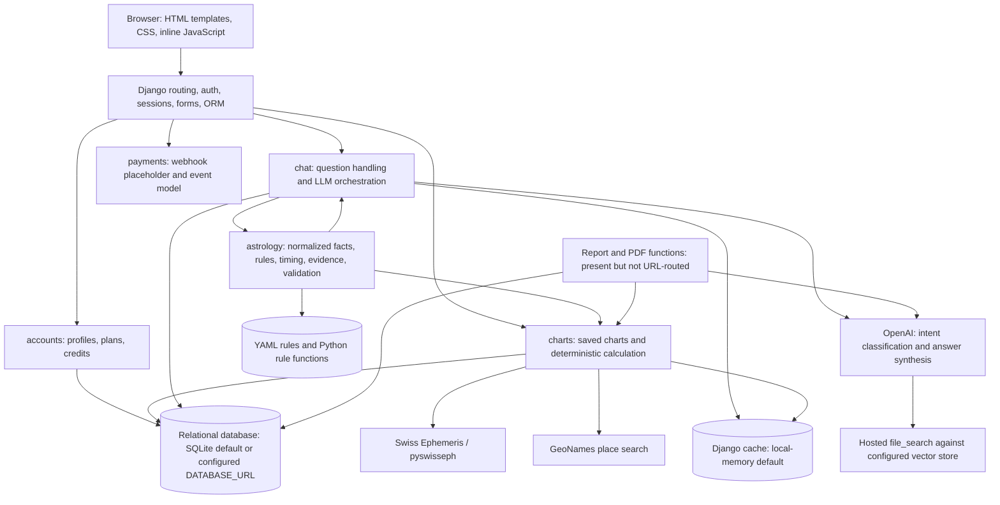
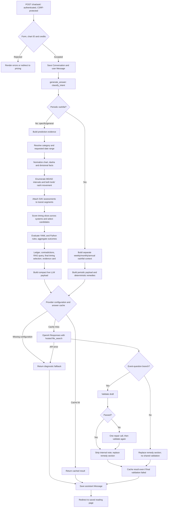
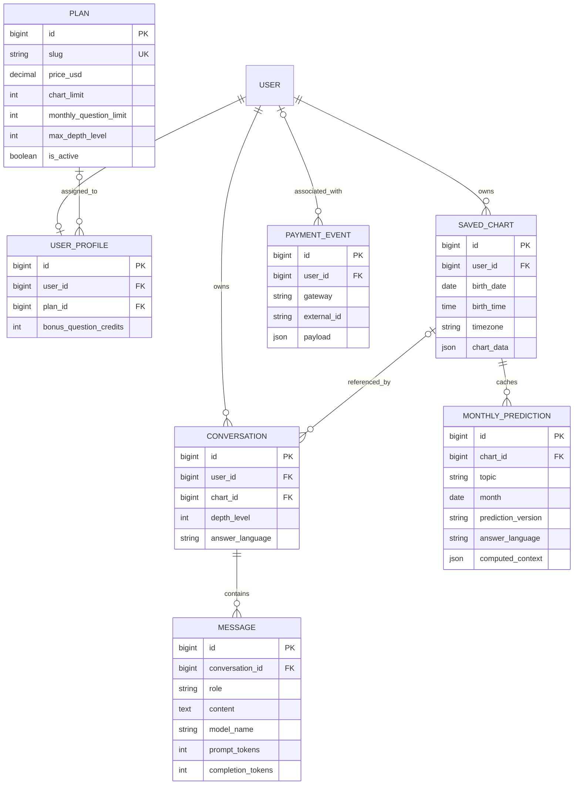

# AstroGPT — AS-IS Architecture

**Snapshot date:** 7 November 2026 (Asia/Bangkok).  
**Scope:** current working-tree source, including uncommitted changes; not just the last Git commit.  
**Purpose:** describe what exists and how it is connected, not propose a replacement architecture.

## 1. Scope, evidence, and status definitions

This review inspected the Django project, its four application packages, the `astrology/` domain package, Python/YAML rule sources, migrations, templates, static assets, tests, management commands, dependency declarations, and project documentation. It used static inspection and source inventories. It did not execute prediction requests, contact external providers, run migrations, install dependencies, or inspect private book/vector-store contents. Deployment configuration, applied migration state, actual database records, configured provider credentials, and hosted retrieval quality are not established by this document.

The source inventory contains **136 Python files across the seven main package/tool directories**, **223 YAML rule entries across seven files**, and **70 `test_*` methods** in the astrology tests. These are source counts, not a claim that all paths are exercised or all tests were rerun for this documentation task. Sources: the package tree below; [astrology/tests.py](astrology/tests.py); [astrology/test_transit_timeline.py](astrology/test_transit_timeline.py); [rule loader](astrology/rules/loader.py), `RULE_FILES`.

| Label | Meaning in this document |
|---|---|
| **IMPLEMENTED** | Executable implementation exists and the specified entry point/caller is identified. External integrations still require credentials and services. |
| **PARTIALLY IMPLEMENTED** | Some executable pieces exist, but a required connection, complete behavior, or enforcement is absent. The missing part is named explicitly. |
| **PLANNED** | Explicitly described in project instructions, TODOs, or deferred metadata; that statement alone is not evidence of execution. |
| **NOT FOUND** | No implementation was located in the inspected repository. This does not establish what may exist in an external service or a different repository. |

Planning documents are secondary evidence. For example, [AGENTS.md](AGENTS.md) still describes a Yogini skeleton, and [architecture_todo.md](astrology/docs/architecture_todo.md) still lists live prompt/validation integration as future work. Current code implements Yogini calculations and invokes validation/repair. Conversely, a function or template existing on disk does not prove it is reachable through a URL.

## 2. Architecture at a glance

AstroGPT is a **Django server-rendered monolith**. Python calculates astrology facts, combines YAML and Python rules, builds evidence, and invokes an LLM synchronously. The browser submits ordinary HTML forms; it does not run the astrology engine. A separate periodic-reading path and a report-generation subsystem coexist with the event-question pipeline.

Sources: [astro_site/urls.py](astro_site/urls.py), `urlpatterns`; [chat/views.py](chat/views.py), `ask_question`; [chat/llm_engine.py](chat/llm_engine.py), `generate_answer`; [charts/views.py](charts/views.py), `chart_create`; [prediction service](astrology/services/prediction_service.py), `build_prediction_evidence`.



The bidirectional domain/application arrows are intentional: this is the current import structure, not a clean dependency inversion. In particular, `astrology` imports `chat.prediction_context` and `chat.timing_windows`; `charts` imports dasha calculations from `astrology`; and normalized calculations reuse `charts` helpers. See section 10.

### Capability summary

| Component | Status | Evidence / qualification |
|---|---|---|
| Accounts, login, saved charts, question/history pages | IMPLEMENTED | [accounts/views.py](accounts/views.py), [charts/views.py](charts/views.py), [chat/views.py](chat/views.py), and their URL modules. |
| D1 and fifteen divisional charts, Vimshottari, Yogini, Chara | IMPLEMENTED | `build_vedic_chart`, `build_vimshottari_dasha`, `build_yogini_periods`, `build_chara_dasha`. |
| Period-specific MD/AD transit timeline followed by SAV assessment | IMPLEMENTED for event-question timing | [dasha_transit_timeline.py](astrology/calculations/dasha_transit_timeline.py), `build_dasha_transit_timeline`; daily noon-UTC resolution. |
| Uniform timing logic across event, rashifal, and report paths | PARTIALLY IMPLEMENTED | Other paths retain independent sampling/arc logic in `chat/rashifal_context.py` and `charts/yearly_predictions.py`. |
| Deterministic rule triggering and scoring | IMPLEMENTED | `run_rule_engine`, `aggregate_scores`, plus Python evaluators invoked by `build_prediction_evidence`. |
| Hosted RAG during chat synthesis | IMPLEMENTED integration; operational contents unverified | `generate_answer` and `_generate_rashifal_answer` pass a configured vector-store ID to `file_search`. |
| Local ingestion, OCR pipeline, chunking, embeddings, reranking | NOT FOUND | No application upload/indexing jobs or local implementations; source notes describe prior manual book review. |
| Validation plus one repair attempt | IMPLEMENTED | `generate_answer`, `validate_answer`, `_repair_answer`. |
| Mandatory pass-before-publication quality gate | PARTIALLY IMPLEMENTED | The answer is still returned/cached after a failed second validation; periodic/report paths do not run the same validator. |
| Report/PDF generation | PARTIALLY IMPLEMENTED as a feature | View functions, templates, and generation code exist; corresponding routes are absent from `charts/urls.py`. |
| Paid checkout, signed gateway webhooks, subscription fulfillment | PARTIALLY IMPLEMENTED scaffold | `PaymentEvent` exists; the sole payment view returns placeholder text. |
| Exact muhurta / complete Panchanga | PLANNED requirement; calculator NOT FOUND | [AGENTS.md](AGENTS.md); preliminary-warning checks exist, not the full requested calculation pipeline. |
| Background jobs / shared production cache / deployment manifests | NOT FOUND | No worker/task scheduler setup, custom `CACHES`, or deployment definitions in the inspected source. |

## 3. Technology stack and project structure

### 3.1 Declared stack

Versions below are **dependency ranges in source**, not verified deployment versions. Source: [requirements.txt](requirements.txt).

| Layer | Current implementation |
|---|---|
| Language/runtime | Python; `zoneinfo`, dataclasses, annotations, and modern union syntax are used. No repository-wide Python version pin was found. |
| Web framework | Django `>=5.2,<6.0`; Django templates, forms, middleware, ORM, admin, auth, messages, sessions, staticfiles. |
| Authentication | `django-allauth[socialaccount] >=65,<66`; Google provider plus Django username/email login. |
| Database | SQLite when `DATABASE_URL` is empty; `dj-database-url >=2.2,<3` parses configured database URLs; `psycopg[binary] >=3.2,<4` supports PostgreSQL. |
| Astrology | `pyswisseph >=2.10,<3`; actual placement/transit implementation imports `swisseph`. `kerykeion >=4,<5` is declared, but no application import was found. |
| LLM/retrieval | `openai >=1,<2`; Responses API for synthesis/file search; Chat Completions for ambiguous intent classification. |
| Rules | PyYAML `>=6,<7`; Python evaluators coexist with YAML rules. |
| PDF | WeasyPrint `>=62,<64`; optional system Chrome/Edge subprocess fallback. |
| Payments | Stripe `>=10,<12` and Razorpay `>=1.4,<2` declared; no executable gateway integration found. |
| Configuration | `python-dotenv >=1,<2`; `astro_site/settings.py` loads `.env` and reads environment variables. |
| Frontend | HTML templates, `static/css/site.css`, inline JavaScript, inline chart/SVG template rendering, Google Fonts. No SPA framework, Node build manifest, or frontend state library found. |

Sources beyond requirements: [settings](astro_site/settings.py); [chart engine](charts/astro_engine.py); [LLM engine](chat/llm_engine.py); [base template](templates/base.html); [north chart partial](templates/charts/partials/north_chart.html).

### 3.2 Project map

```text
Astro_Code_base/
├── manage.py                         Django CLI entry point
├── requirements.txt                  Dependency ranges
├── .env.example                      Configuration variable names / example defaults
├── AGENTS.md                         Architectural and answer-quality requirements
├── astro_site/                       Settings, top-level routes, WSGI/ASGI, localization
├── accounts/                         Plans, profiles, credits, login redirects, admin
├── charts/                           Chart engine, shared astrology helpers, saved charts
│   ├── astro_engine.py               D1/vargas; attaches dashas, SAV, Jaimini, yogas
│   ├── yearly_predictions.py         Separate monthly-report prediction subsystem
│   ├── report_context.py             Report-specific facts and dosha summaries
│   └── management/commands/
│       └── refresh_chart_data.py     Manual regeneration of stored chart JSON
├── chat/                             User questions and actual LLM orchestration
│   ├── llm_engine.py                 Event/rashifal generation, cache, repair, remedies
│   ├── intent_engine.py              Rules-first intent classification, optional LLM
│   ├── prediction_context.py         Categories, temporal scope, legacy context builder
│   ├── timing_windows.py             Multi-system timing candidates and ranking inputs
│   ├── rashifal_context.py           Periodic reading evidence and transit arcs
│   └── templatetags/chat_formatting.py  Escaped Markdown-like rendering
├── astrology/                        Python domain package, not an installed Django app
│   ├── calculations/                 Fact normalization and Python rule evaluators
│   ├── rules/                        YAML loader, evaluator, weighted aggregation
│   ├── evidence/                     Ledger, contradiction and confidence summaries
│   ├── services/                     Prediction orchestration, timing selector, evidence card
│   ├── rag/                          Deterministic query construction
│   ├── synthesis/                    Payload/schema and a second prompt definition
│   ├── validation/                   Heuristic answer checks and repair instructions
│   ├── docs/                         Source notes, TODOs, extraction notes
│   ├── tests.py                      Broader domain tests
│   └── test_transit_timeline.py       Timeline and payload regression tests
├── payments/                         Payment event model and placeholder webhook
├── templates/                        Server-rendered pages and chart/report partials
├── static/css/site.css               Shared application styles
└── tools/generate_question_flow_pdf.py  Standalone documentation-PDF generator
```

`astro_site/settings.py:INSTALLED_APPS` registers `accounts`, `charts`, `chat`, and `payments`, alongside Django/allauth. `astrology/` supplies ordinary Python code and has no models/migrations of its own. Existing migration files are under each model-owning app. WSGI/ASGI entry points exist, but no deployment topology is specified by those files alone.

## 4. Major modules and responsibilities

| Module / package | Responsibility and entry points | Status / important boundary |
|---|---|---|
| [astro_site/settings.py](astro_site/settings.py) | Environment-based configuration, middleware, database, authentication, template/static/media paths. | IMPLEMENTED; defaults include development-friendly settings. |
| [astro_site/localization.py](astro_site/localization.py), [context_processors.py](astro_site/context_processors.py) | Ten answer-language choices, language normalization, remedy notes, Google-login UI availability. | IMPLEMENTED; not evidence of complete translation of every UI string. |
| [accounts/credits.py](accounts/credits.py) | `get_or_create_profile`, `plan_credit_limit`, `successful_answer_count`, `question_credit_status`. | IMPLEMENTED; counts all assistant messages, not monthly billing-period consumption. |
| [charts/astro_engine.py](charts/astro_engine.py) | `build_vedic_chart` owns natal calculations; `build_placeholder_chart` preserves birth details without coordinates. | IMPLEMENTED deterministic calculator; the LLM does not calculate placements here. |
| [charts/vedic_utils.py](charts/vedic_utils.py) | Sign/house arithmetic, house lordship, dignity, planetary aspects, mutual aspects, transit longitude/context, SAV lookup. | IMPLEMENTED; reused across most calculation paths. |
| [charts/jaimini.py](charts/jaimini.py), [astrology/calculations/jaimini.py](astrology/calculations/jaimini.py) | Chara schedule versus enhanced Jaimini facts: karakas, Karakamsha, padas, aspects, yogas, condition/timing checklists. | IMPLEMENTED selected methods; not every Jaimini technique. |
| [charts/yogini_*.py](charts/yogini_alignment.py) | Contextual lord quality, pair relationships, low-weight baselines, event confirmation, reference frames, snapshots, transit support. | IMPLEMENTED helpers; explicitly deferred factors remain. |
| [astrology/services/prediction_service.py](astrology/services/prediction_service.py) | `build_prediction_evidence` coordinates event-question facts, rules, scores, ledger, timing, RAG query and prompt payload. | IMPLEMENTED evidence service; does not itself make the OpenAI request. |
| [chat/llm_engine.py](chat/llm_engine.py) | `generate_answer` and `_generate_rashifal_answer` perform actual provider calls, caches, fallback text, repair and remedy substitution. | IMPLEMENTED live traffic orchestrator. `generate_placeholder_answer` is an alias to actual generation, despite its name. |
| [chat/prediction_context.py](chat/prediction_context.py) | `CATEGORY_RULES`, `classify_question`, `detect_question_scope`, natural-karaka/location assessments, older `build_prediction_context`. | IMPLEMENTED shared helpers; the legacy full context builder has no production caller located. |
| [chat/timing_windows.py](chat/timing_windows.py) | `build_timing_windows`, `_score_micro_period`, merging, selected-window evidence attachment. | IMPLEMENTED; depends on chart helpers and category definitions in `chat`. |
| [astrology/services/timing_window_service.py](astrology/services/timing_window_service.py) | Final intersection-tier ranking and best/secondary window selection. | IMPLEMENTED second ranking stage. |
| [astrology/services/evidence_card_service.py](astrology/services/evidence_card_service.py) | Compact deterministic contract for best/secondary windows, reasons, scoped transits, cautions, and confidence. | IMPLEMENTED; used by the event synthesis payload. |
| [astrology/rules/](astrology/rules/engine.py) | File-loaded deterministic conditions and outcome aggregation. | IMPLEMENTED alongside direct Python rule emitters. |
| [astrology/rag/query_builder.py](astrology/rag/query_builder.py) | `build_rag_query`, `build_rag_context_request` derive retrieval terms from deterministic evidence. | IMPLEMENTED query preparation; not a retrieval client or ingestion pipeline. |
| [astrology/synthesis/](astrology/synthesis/prompt_builder.py) | Structured evidence payload, rule selection, answer schema, independent `SYSTEM_INSTRUCTIONS`. | IMPLEMENTED; live final instructions come from `chat.llm_engine._system_instructions`. |
| [astrology/validation/](astrology/validation/validator.py) | `validate_answer` combines quality, evidence, genericity, completeness, contradiction and specificity checks. | IMPLEMENTED heuristics, not complete factual proof or a hard publication gate. |
| [charts/yearly_predictions.py](charts/yearly_predictions.py) | `get_or_create_yearly_predictions` creates/reuses 13 months of topic predictions; optional LLM bullet generation. | IMPLEMENTED callable subsystem, separate from event RAG/validation; report routes absent. |
| [charts/views.py](charts/views.py) | Chart lifecycle, GeoNames suggestions, chart refresh, report/PDF functions. | Chart routes IMPLEMENTED; reports PARTIALLY IMPLEMENTED due to missing routes. |
| [payments/views.py](payments/views.py) | `webhook_placeholder` returns readiness text. | Scaffold only; no payment processing. |

## 5. End-to-end user question processing

### 5.1 Shared HTTP lifecycle

1. `GET /chat/ask/` requires login, loads only the user's charts, creates an unbound `AskQuestionForm`, and computes credit status.
2. The HTML form submits `chart_id`, `answer_language`, `question`, and CSRF token to the same route. Browser validation and inline JavaScript display chart errors/loading feedback. Dropdowns remain enabled so their values are submitted.
3. On a valid form, `ask_question` checks credits. It rejects a missing chart ID with a message, but a supplied non-owned/nonexistent numeric ID can yield `chart=None`; generation then receives `{}` instead of a chart. This is an unresolved validation gap.
4. The view creates a **new** `Conversation` with depth fixed to `Conversation.FULL`, saves the user `Message`, and calls `generate_placeholder_answer` → `generate_answer` synchronously.
5. After generation returns, it saves the assistant message and its model/token metadata and redirects to `conversation_detail`.
6. History reads stored messages. It does not rerun the prediction. No follow-up message endpoint or conversation-history input to the LLM was found; a conversation currently represents a single question/answer exchange.

Sources: [chat/views.py](chat/views.py), `ask_question`, `conversation_detail`, `question_history`; [chat/forms.py](chat/forms.py), `AskQuestionForm`; [templates/chat/ask.html](templates/chat/ask.html), submit handler; [chat/models.py](chat/models.py).

### 5.2 Question-processing flow diagram



This diagram deliberately shows the actual behavior after a failed repair. It does not imply validation always blocks publication. Sources: [chat/llm_engine.py](chat/llm_engine.py), `generate_answer`, `_generate_rashifal_answer`, `_fallback_answer`, `_repair_answer`; [validator](astrology/validation/validator.py), `validate_answer`.

### 5.3 Event-question evidence pipeline

`build_prediction_evidence` performs the following operations:

| Stage | Actual work / source |
|---|---|
| Category and time scope | `_engine_category` adds business keywords to `classify_question`; `detect_question_scope` returns start/end, fixed/scan flag, intent and instructions. A future/general question without a target uses **36 months**. Explicit next year means the next calendar year; month/year means that calendar month. Unspecified retrospective questions retain a separate five-year lookback. |
| Normalized chart facts | `build_chart_facts` wraps stored D1/varga output. Category configuration chooses primary/secondary charts and relevant houses. It does not recreate an absent natal chart. |
| Dasha and interpretive facts | `build_dasha_facts` gets Vimshottari, enhanced Jaimini, Yogini, reference frames and event confirmation at the range start. `build_parashari_facts` and `build_varga_assessment` add deterministic findings. |
| Transits and timing candidates | `build_transit_facts` first builds the period-specific timeline and future windows. It also retains a separately labeled range-start snapshot for compatibility. |
| Rule layer | `run_rule_engine` plus generic/D1/D2/D3/D4/D7/D9/D10/D12/D16 Python evaluators emit rules. `aggregate_scores` combines all emitted outcomes. |
| Evidence interpretation controls | `build_evidence_ledger` and `resolve_contradictions` normalize support/pressure. `build_rag_context_request` prepares evidence-derived retrieval terms. |
| Final selection and contract | `build_timing_window_selection` ranks precomputed candidates; `build_evidence_card` packages final evidence. `astrology.synthesis.prompt_builder.build_prompt_payload` selects rules and wraps facts. `build_confidence_summary` adds a separate confidence summary. Incomplete transit coverage marks timing preliminary. |
| Live payload | `chat.llm_engine.build_prompt_payload` → `_compact_live_evidence` / `_compact_transits` selects the fields actually sent to the model, with best-window-scoped remedies. |

Sources: [prediction_service.py](astrology/services/prediction_service.py), `build_prediction_evidence`; [prediction_context.py](chat/prediction_context.py), `CATEGORY_RULES`, `detect_question_scope`; [transit_facts.py](astrology/calculations/transit_facts.py), `build_transit_facts`; [live LLM payload](chat/llm_engine.py), `build_prompt_payload`.

### 5.4 Periodic rashifal is a different branch

`classify_intent` uses deterministic keywords first; ambiguous questions may invoke a small Chat Completions classifier. `periodic` routes to `_generate_rashifal_answer`; other classifications use event-question evidence. This LLM classifies intent only, not planetary facts or rule applicability.

`build_rashifal_context` calculates life areas, active Vimshottari, Jaimini cross-checks and mutual aspects. Weekly/monthly paths call `build_transit_priority_context`. Annual output uses monthly snapshots, significant months, slow-planet arcs, and an independent dasha-lord transit arc; the Moon has a special natal-anchor treatment. **It does not use the new event-question MD/AD timeline pipeline.** `_generate_rashifal_answer` invokes hosted file search and replaces remedies but does not call `validate_answer` or `_repair_answer`.

Sources: [intent_engine.py](chat/intent_engine.py), `classify_intent`, `_rule_classify`, `_llm_classify`; [rashifal_context.py](chat/rashifal_context.py), `build_rashifal_context`, `_build_month_snapshot`, `_build_dasha_lord_transit_arc`; [llm_engine.py](chat/llm_engine.py), `_generate_rashifal_answer`.

### 5.5 Report prediction path

`charts.views._report_payload` calls `get_or_create_yearly_predictions`, which generates **13 calendar months**, chooses age/profile-dependent topics, and reuses persistent `MonthlyPrediction` rows by chart/topic/month/version/language. Missing rows run `_monthly_context` and optionally `_llm_month_predictions`; model/API/JSON failures fall back to deterministic bullets. This call has no file-search tool and does not use the event answer validator. The report subsystem is present in code but currently has no report URL registration.

Sources: [charts/yearly_predictions.py](charts/yearly_predictions.py), `yearly_topics_for_chart`, `_monthly_context`, `_llm_month_predictions`, `get_or_create_yearly_predictions`; [charts/views.py](charts/views.py), `_report_payload`; [charts/urls.py](charts/urls.py).

## 6. Astrology calculation engine

### 6.1 Natal chart and coordinates — IMPLEMENTED

`build_vedic_chart` converts local birth datetime using `ZoneInfo`, sets Swiss Ephemeris Lahiri sidereal mode, computes Julian UT, obtains the ascendant using `swe.houses_ex`, and computes classical planets plus the true node. Ketu is derived opposite Rahu. It stores degree formatting, sign/house, nakshatra/pada and motion/retrograde information derived from speed, builds chart houses, and assigns seven Jaimini karakas by within-sign longitude, excluding Rahu/Ketu.

**House-system distinction:** the ascendant call requests `b"P"`, but the displayed/stored house assignments are sign-relative whole-sign houses built by `_planet_row` / `_build_houses`; returned cusp positions are not the persisted bhava-house system. An invalid timezone silently falls back to UTC. Missing coordinates return a calculation error or a placeholder chart, depending on the caller.

Sources: [charts/astro_engine.py](charts/astro_engine.py), `_local_datetime_to_utc`, `_planet_row`, `_build_houses`, `_assign_jaimini_karakas`, `build_vedic_chart`, `build_placeholder_chart`; [charts/forms.py](charts/forms.py), `SavedChartForm`; [charts/geocoding.py](charts/geocoding.py), `search_places`.

### 6.2 Divisional charts — IMPLEMENTED calculations, uneven rule coverage

The engine constructs **D1, D2, D3, D4, D7, D9, D10, D12, D16, D20, D24, D27, D30, D40, D45, D60**. Individual longitude-transform functions implement the divisions; `_build_divisional_chart` transforms the ascendant and planets and reconstructs houses. `SUPPORTED_VARGAS` and `VARGA_PURPOSES` expose the same chart set in normalized facts.

| Charts | Executable calculation | Interpretation integration |
|---|---|---|
| D1 | Natal longitudes and whole-sign houses | Parashari facts, D1 functional lordship rules, YAML rules. |
| D2 / D3 / D4 / D7 / D9 / D10 / D12 / D16 | Dedicated `_hora_longitude`, `_drekkana_longitude`, `_chaturthamsha_longitude`, `_saptamsa_longitude`, `_navamsha_longitude`, `_dasamsa_longitude`, `_dwadasamsa_longitude`, `_shodashamsa_longitude` | Dedicated Python rule modules are invoked by the prediction service; YAML/generic checks also coexist. |
| D20 | `_vimshamsa_longitude` | YAML/generic support exists. Dedicated `evaluate_d20_vimshamsha_rules` is implemented but no production caller was found. |
| D24 / D27 / D30 / D40 / D45 / D60 | Dedicated transform functions in the chart engine | Fact extraction plus selected YAML/generic rules; no matching dedicated invoked Python module for every chart. |

Sources: [chart engine](charts/astro_engine.py), `_build_divisional_chart` and named transform functions; [varga facts](astrology/calculations/varga.py), `SUPPORTED_VARGAS`, `build_varga_facts`, `build_chart_facts`, `build_varga_assessment`; [prediction service](astrology/services/prediction_service.py), evaluator imports/calls; [D20 evaluator](astrology/calculations/d20_vimshamsha_rules.py), `evaluate_d20_vimshamsha_rules`.

Coverage must not be inferred from a chart key alone. Category configuration controls which charts receive emphasis. For example, the current `job` category requests D1/D10, whereas [AGENTS.md](AGENTS.md) also calls for D9 in serious career/business evidence. Reports expose only the subset in `REPORT_CHART_KEYS`, not all calculated vargas. Sources: [chat/prediction_context.py](chat/prediction_context.py), `CATEGORY_RULES`; [charts/report_context.py](charts/report_context.py), `REPORT_CHART_KEYS`.

### 6.3 Dashas and Jaimini

| System | AS-IS behavior | Status / source |
|---|---|---|
| Vimshottari | Moon nakshatra determines starting lord and remaining balance. Generates MD timeline and proportional ADs using the 120-year scheme and solar-year day conversion. Default `cycles=1`; schedule starts at birth with balance. | IMPLEMENTED MD/AD; [vimshottari.py](astrology/calculations/vimshottari.py), `birth_mahadasha`, `generate_antardashas`, `generate_mahadasha_timeline`, `build_vimshottari_dasha`. |
| Vimshottari deeper subperiods | Return metadata explicitly says Pratyantardasha is not generated. | PLANNED / NOT FOUND calculator in this repository; `build_vimshottari_dasha.method`. |
| Chara Dasha | Sign sequence based on Lagna grouping, selected sign lord and counting direction, full-years treatment for own sign, major durations and subperiods, two cycles by default. | IMPLEMENTED selected method; [charts/jaimini.py](charts/jaimini.py), `_period_calculation`, `_subperiods`, `build_chara_dasha`. |
| Jaimini interpretive facts | Rashi aspects; AK/AmK and other karakas; Karakamsha; twelve house padas including AL/UL; Arudha gains/career factors; starter Rajayogas; D9 checks; running-sign-as-Lagna; relationship, childhood and caution metadata. | IMPLEMENTED subset; [astrology/calculations/jaimini.py](astrology/calculations/jaimini.py), `build_enhanced_jaimini_facts` and constituent `build_*` helpers. |
| Planetary padas | Explicit deferred/unscored status; house padas use the code's direct-counting method with `exceptions_applied=False`. | PLANNED/deferred planetary calculation; `build_padas` in the Jaimini facts module. |
| Yogini | Eight Yoginis, 36-year cycle, Moon-nakshatra formula and birth balance, proportional subperiods, four cycles by default. Normalized contextual lord/pair and divisional assessment. | IMPLEMENTED, not a skeleton; [yogini.py](astrology/calculations/yogini.py), `build_yogini_periods`, `build_yogini_facts`; [charts/yogini_alignment.py](charts/yogini_alignment.py), `build_yogini_alignment`. |
| Annual Yogini | Builds a 360-day annual schedule from supplied annual start, birth nakshatra, completed years and remaining Moon fraction. | PARTIALLY IMPLEMENTED feature: isolated calculator with `scoring_status=isolated_until_varshaphala_chart_is_calculated`; [annual_yogini.py](astrology/calculations/annual_yogini.py), `build_annual_yogini_periods`. |
| Solar return / full Varshaphala | Required annual-chart calculation was not located. | PLANNED by annual-Yogini metadata; calculator NOT FOUND. |

Date boundaries are not fully standardized: the new transit timeline and `chat.timing_windows._vimshottari_at` use exclusive source period ends; `astrology.calculations.dasha_facts._current_period` and several older selectors use inclusive ends. A shared end/start day can therefore resolve differently across paths. Dates are stored primarily as ISO date strings, not exact dasha-transition instants.

### 6.4 Transit and Ashtakavarga pipeline

**Implemented event-question order:**

1. `build_dasha_transit_timeline` enumerates MD/AD boundaries over the requested inclusive date range; source period ends are treated as exclusive.
2. For each interval, it tracks each distinct active lord once. A same-lord pair such as Venus/Venus retains the role `Mahadasha and Antardasha lord` without duplicate position calculations.
3. It samples positions **daily at 12:00 UTC**, groups consecutive days by rashi, and records rashi, natal-Lagna house and inclusive segment dates. Retrograde re-entry becomes another segment.
4. Only after the movement timeline exists, a second pass attaches natal-house **Sarvashtakavarga** points, threshold and strength classification. Missing Lagna/SAV evidence remains unavailable and marks output preliminary; it is not represented as zero strength.
5. Timing construction splits at MD/AD/Jaimini/Yogini boundaries and the precomputed rashi transitions. `_score_micro_period` uses scoped MD/AD transit evidence, alongside midpoint checks of other systems and divisional support.
6. Candidates are merged by Vimshottari pair, ranked, and the top eight retain all relevant transit segments. The complete MD/AD timeline remains available even for intervals not selected into the top eight.
7. `summarize_segments` exposes duration-weighted support per lord. `_compact_future_window`, timing selection, evidence cards and the live prompt preserve both lords' evidence instead of truncating to four segments.

Sources: [dasha_transit_timeline.py](astrology/calculations/dasha_transit_timeline.py), `build_dasha_transit_timeline`, `segments_in_range`, `summarize_segments`; [timing_windows.py](chat/timing_windows.py), `build_timing_windows`, `_score_micro_period`, `_build_convergence_window`, `_enrich_with_transit_segments`; [transit_facts.py](astrology/calculations/transit_facts.py), `build_future_transit_windows`, `_compact_future_window`; [evidence_card_service.py](astrology/services/evidence_card_service.py), `_transit_basis`.

**Resolution limits:** these are date-resolution samples, not exact ingress times. The midpoint-style general transit convergence and Jaimini/Yogini refinements remain separate from the complete Vimshottari-lord movement table. Merged windows inherit the highest-scoring micro-period's representative system metadata, rather than proving uniform support on every day. The detailed transit table must therefore not be summarized as one unchanging transit state.

**Ashtakavarga implementation:** `build_ashtakavarga` uses contributor-house tables for the seven classical planets and Ascendant to construct Bhinna scores, expected-total checks and a Sarva total check of 337. Rows map rashi scores to natal houses. Event transit scoring currently uses **SAV**, with `>28` strong, `25–28` moderate, lower values weak. It does not implement a separate Rahu/Ketu BAV or use every available planet-specific BAV score for event ranking. Sources: [charts/ashtakavarga.py](charts/ashtakavarga.py), `build_ashtakavarga`; [charts/vedic_utils.py](charts/vedic_utils.py), `get_sarvashtakavarga_points`, `transit_context_for_lord`; [timeline](astrology/calculations/dasha_transit_timeline.py), SAV pass.

**Other transit paths:** `build_transit_priority_context` scores sampled events by dasha-lord conjunction/ownership/role, relevant house activation, SAV and natal mutual-aspect axes. `evaluate_transit_convergence` checks slow support plus faster refiners. The range-start snapshot is still stored in `build_transit_facts`, clearly labeled, but the live compact transit payload omits its `dasha_lord_transits`. Rashifal/report functions retain their own sampling. Sources: [charts/transit_priority.py](charts/transit_priority.py), `_samples_for_horizon`, `_score_transit_event`, `build_transit_priority_context`; [charts/yogini_transit_convergence.py](charts/yogini_transit_convergence.py), `evaluate_transit_convergence`; [chat/llm_engine.py](chat/llm_engine.py), `_compact_transits`.

### 6.5 Other implemented and deferred calculations

| Capability | Status and boundaries | Evidence |
|---|---|---|
| Nakshatra/pada, natal house lordship, own/exalted/debilitated dignity, aspects and mutual aspects | IMPLEMENTED deterministic helpers. This is not full planetary strength calculation. | `charts.astro_engine._nakshatra_details`; `charts.vedic_utils.get_planet_dignity`, `aspected_houses`, `natal_mutual_aspects`. |
| Yoga detection | IMPLEMENTED selected Pancha Mahapurusha, Moon, conjunction, lordship and Vipareeta patterns. | [charts/yogas.py](charts/yogas.py), `detect_yogas` and `_add_*` functions. |
| Manglik and Kaal Sarpa summaries | IMPLEMENTED simplified report checks, not an exhaustive dosha doctrine. | [charts/report_context.py](charts/report_context.py), `build_chart_report_context`, `_has_kaal_sarpa_dosha`. |
| Sade Sati | IMPLEMENTED Saturn-sign search around natal Moon, current/upcoming period and phase windows. Report consumer currently unrouted. | [charts/sade_sati.py](charts/sade_sati.py), `build_sade_sati_context`, `_periods`, `_phase_windows`. |
| Reference frames and event confirmation | IMPLEMENTED Lagna/Moon/karaka/varga facts and multi-system overlap classification. | `charts.yogini_reference_frames.build_reference_frames`; `charts.yogini_event_confirmation.build_event_confirmation`. |
| Remedies | IMPLEMENTED deterministic language-specific mantra lookup, MD/AD deduplication and final answer-section substitution. | [charts/remedies.py](charts/remedies.py), `remedies_for_dasha`; `chat.llm_engine._apply_deterministic_remedy`. |
| Full Shadabala, combustion, moolatrikona, friend/enemy signs, Gandanta and related refinements | PLANNED/deferred in contextual Yogini assessment; no full shared implementation found. Some limited approximations/metadata exist elsewhere, so this is not a claim that every related word is absent. | [charts/yogini_principles.py](charts/yogini_principles.py), `evaluate_yogini_lord.deferred_factors`; [varga_generic_rules.py](astrology/calculations/varga_generic_rules.py), module notes. |
| Complete muhurta factors and election search | PLANNED requirement; integrated calculator NOT FOUND. A D16 part-to-`tithi_lord` mapping is not a lunar tithi/Panchanga calculator. | [AGENTS.md](AGENTS.md); `astrology.validation.answer_validator._muhurta_basis_present`; `astrology.calculations.d16_shodashamsha_rules._tithi_lord_info`. |

## 7. Rule engine: storage, execution, combination and priority

### 7.1 Two rule stores are active

**YAML store — IMPLEMENTED.** `RULE_FILES` lists seven local files. The current source counts are:

| File | Entries |
|---|---:|
| [parashari_rules.yaml](astrology/rules/parashari_rules.yaml) | 38 |
| [vimshottari_rules.yaml](astrology/rules/vimshottari_rules.yaml) | 9 |
| [life_area_rules.yaml](astrology/rules/life_area_rules.yaml) | 34 |
| [jaimini_rules.yaml](astrology/rules/jaimini_rules.yaml) | 50 |
| [divisional_rules.yaml](astrology/rules/divisional_rules.yaml) | 82 |
| [yogini_rules.yaml](astrology/rules/yogini_rules.yaml) | 6 |
| [transit_rules.yaml](astrology/rules/transit_rules.yaml) | 4 |
| **Total** | **223** |

`load_rules` uses `yaml.safe_load`, accepts a list or a top-level `rules` list, adds `source_file`, and reports missing required fields/type problems. Required keys are rule ID, system, category, condition, interpretation, outcomes, weight, polarity and confidence. Book/chapter/page fields are carried forward when supplied but are not all mandatory. Missing files return an empty list; malformed files produce load errors. **Entries with validation errors are still appended to the returned rule list**, so validation is advisory rather than a schema gate. Source: [loader.py](astrology/rules/loader.py), `_load_yaml_file`, `_validate_rule`, `load_rules`.

**Python rules — IMPLEMENTED.** The prediction service also calls generic and chart-specific evaluators, which directly return rule-shaped dictionaries. These do not pass through YAML `evaluate_condition` or its category filtering. This means interpretation logic is split between external rule data and Python conditionals. Source: [prediction_service.py](astrology/services/prediction_service.py), `build_prediction_evidence`; [varga_generic_rules.py](astrology/calculations/varga_generic_rules.py), `evaluate_generic_varga_rules`; the invoked `d*_rules.py` modules.

### 7.2 Condition evaluation

`evaluate_condition` supports nested `all`/`any`, dotted evidence paths, list traversal/indexes and operators `exists`, `equals`, `not_equals`, `in`, `contains`, `contains_any`, `gt`, `gte`, `lt`, `lte`. Leaf conditions pass if any resolved value compares successfully. `run_rule_engine` filters YAML rules by category or `general`, emits metadata/match reasons for every match, and can return skipped-rule reasons.

There is no inference agenda, recursive rule chaining, rule dependency graph, salience queue, or LLM applicability decision in this engine. Missing paths typically yield no values and fail the leaf; invalid comparison operators/types can raise because per-rule execution is not isolated. Source: [engine.py](astrology/rules/engine.py), `_values_at_path`, `_compare`, `evaluate_condition`, `_category_matches`, `run_rule_engine`.

### 7.3 Aggregation and prioritization are distinct stages

1. **Outcome scores:** `aggregate_scores` starts with a business/career score template, adds `int(outcome_value) × int(weight)` for each positive-weight rule, and clamps each outcome to 0–100. Nonpositive weights are ignored. `polarity` and textual `confidence` are not direct multipliers; negative outcome values reduce totals, while risk/delay may be separate positive score dimensions.
2. **Evidence direction/conflicts:** the ledger summarizes rule polarity and system status. The contradiction resolver adds issues/instructions for selected support-versus-pressure combinations. It does not cancel rules or mathematically reconcile every contradiction.
3. **Timing ranking:** `_score_micro_period` computes a capped composite from Vimshottari (0.40), Jaimini (0.25), Yogini (0.20), varga (0.15), plus transit-convergence refinement (0.25). These are heuristic coefficients, not probabilities. `_build_convergence_window` takes the best micro-period as representative. `build_timing_windows` first sorts/caps candidates to eight; the final selector then applies intersection-tier bonus, composite, varga/transit refinement and practical-distance penalty.
4. **Prompt priority:** `_select_rules` reserves up to four rules per requested non-D1 chart, then fills to a default total of forty by weight, deduplicating selected IDs. This affects model-visible evidence only; the preceding numeric aggregation does not globally deduplicate rules.

Sources: [scoring.py](astrology/rules/scoring.py), `aggregate_scores`; [ledger.py](astrology/evidence/ledger.py), `build_evidence_ledger`; [contradiction_resolver.py](astrology/evidence/contradiction_resolver.py), `resolve_contradictions`; [timing_windows.py](chat/timing_windows.py), `_score_micro_period`, `_build_convergence_window`, `build_timing_windows`; [timing_window_service.py](astrology/services/timing_window_service.py), `_ranking_score`; [synthesis/prompt_builder.py](astrology/synthesis/prompt_builder.py), `_select_rules`.

**Risk:** YAML, generic varga and dedicated chart rules can describe overlapping factors. Because `all_triggered` is concatenated before aggregation, overlapping outcomes can be counted multiple times. Prompt deduplication does not fix that scoring-level overlap.

## 8. RAG and LLM integration

### 8.1 Implemented boundary

The repository implements **evidence-conditioned generation with a hosted retrieval tool**, not a complete locally managed RAG platform. Deterministic facts and rules are prepared before the event-answer model call; the model may use `file_search` for supporting book context. The actual uploaded corpus and provider-side retrieval operations are not inspectable from this source.

| RAG stage | Status | AS-IS evidence |
|---|---|---|
| Book source tracking / paraphrased deterministic rules | IMPLEMENTED metadata | YAML and Python rules carry book/chapter/page references; `astrology/docs/*source_notes.md` describes reviewed sources. This is not automated ingestion. |
| Local upload/ingestion API, document lifecycle, OCR execution jobs | NOT FOUND | No app uploader, parser/OCR worker, `files.create`, `vector_stores`, or `file_batches` implementation located. `yogini_ocr_task.md` records manual source examination/extraction history. |
| Chunking strategy and chunk metadata | NOT FOUND locally | No chunk-size/overlap settings, local chunk model or chunk persistence found. Hosted defaults/configuration cannot be inferred. |
| Embedding model / embedding jobs | NOT FOUND locally | No embeddings API calls, local embedding library, model selection or embedding storage code located. |
| Vector storage | IMPLEMENTED external reference only | `OPENAI_VECTOR_STORE_ID` is read from settings and passed to hosted `file_search`; no local vector database schema or store administration. |
| Deterministic query construction | IMPLEMENTED | `build_rag_query` combines category, selected rule IDs/metadata, dasha/Jaimini/Yogini facts, ledger, contradictions and timing terms, capped by `MAX_TERMS`. |
| Query enforcement | PARTIALLY IMPLEMENTED | The query is embedded as `rag_context_request` inside the JSON input. The API call does not explicitly execute that exact query as a separate search request or verify which query the model used. |
| Retrieval during event synthesis | IMPLEMENTED integration | Responses tool: `file_search`, configured `vector_store_ids`, `max_num_results=8`; repair uses the same tool. |
| Retrieval during rashifal synthesis | IMPLEMENTED integration | Same hosted tool, `max_num_results=6`. No event rule/query-builder pipeline on this branch. |
| Retrieval for monthly report bullets | NOT FOUND | `_llm_month_predictions` invokes Responses without file-search tools. |
| App-owned reranker, score threshold, metadata filters | NOT FOUND | No explicit reranking/threshold/filter code in the live request. Provider-internal behavior is not documented as a local component. |
| Retrieval observability / source persistence | PARTIALLY IMPLEMENTED | `retrieved_sources` starts empty and is not populated from hosted results. Generation consumes `response.output_text`; no file-search result/citation audit is saved to `Message`. |

Sources: [rag/query_builder.py](astrology/rag/query_builder.py), `build_rag_query`, `_fact_terms`, `build_rag_context_request`; [chat/llm_engine.py](chat/llm_engine.py), `_compact_live_evidence`, `generate_answer`, `_repair_answer`, `_generate_rashifal_answer`; [charts/yearly_predictions.py](charts/yearly_predictions.py), `_llm_month_predictions`; [settings](astro_site/settings.py); [Yogini source notes](astrology/docs/yogini_ocr_task.md).

### 8.2 Model choice, prompts and response handling

`model_for_depth` returns the configured `OPENAI_MODEL` or `gpt-4o-mini`; different depth levels currently do not choose different models, and the Ask view always selects FULL. The ambiguous-intent classifier separately hardcodes `gpt-4o-mini` with a small token limit and temperature zero. Main synthesis calls do not set an explicit request timeout, retry policy, maximum output-token budget or provider JSON schema; application defaults are left to the SDK/service.

There are two prompt definitions: `astrology.synthesis.prompt_builder.SYSTEM_INSTRUCTIONS`/`build_prompt_messages`, and the much larger live `chat.llm_engine._system_instructions`. The live payload reuses the domain builder's selected data but does not send `build_prompt_messages` as its instruction source. Actual visible event sections are **Jyotish Analysis, Why We Advise That, Remedy, Practical Guidance** from `REQUIRED_SECTIONS`; these differ from the twelve-section requirement in `AGENTS.md`.

After event synthesis, the validator runs once, a failed draft gets at most one repair call, and the repaired text is checked again. `_strip_validation_note` and `_apply_deterministic_remedy` then modify text **after** that validation. No final post-substitution validation occurs. A second validation failure or repair API failure does not prevent caching/returning the answer.

Sources: [chat/llm_engine.py](chat/llm_engine.py), `model_for_depth`, `_system_instructions`, `generate_answer`, `_repair_answer`, `_apply_deterministic_remedy`; [intent_engine.py](chat/intent_engine.py), `_llm_classify`; [answer_schema.py](astrology/synthesis/answer_schema.py); [synthesis/prompt_builder.py](astrology/synthesis/prompt_builder.py), `build_prompt_messages`; [AGENTS.md](AGENTS.md).

### 8.3 Validation — IMPLEMENTED heuristics, partial factual enforcement

`validate_answer` wraps `validate_astrology_answer` and adds genericity, evidence, completeness, contradiction and specificity issues. Output includes `passed`, numeric `score`, `issues`, `missing_sections`, `missing_evidence`, `generic_phrases_detected`, `unsupported_claims`, and `repair_instruction`. Checks cover selected house/planet evidence, available systems, timing alternatives/launch modes, confidence wording, generic language, some spelling, named charts and transit-period lord coverage.

These checks use text/regex/keyword logic, not a typed claim graph. `_transit_period_issues` checks expected lords in a recognized transit paragraph; it does not prove every stated date, transit position or SAV number against the timeline. `_transit_coverage_issues` requires preliminary wording for incomplete coverage. Some general specificity checks still reference range-start dasha/Jaimini/Yogini facts, which can conflict with window-specific narrative requirements.

Sources: [validator.py](astrology/validation/validator.py), `validate_answer`; [answer_validator.py](astrology/validation/answer_validator.py), `validate_astrology_answer`; [evidence_checker.py](astrology/validation/evidence_checker.py), `_transit_period_issues`, `_transit_coverage_issues`; [specificity_checker.py](astrology/validation/specificity_checker.py), `check_specificity`; other `astrology/validation/*checker.py` modules.

## 9. Database schema and relationships

This section describes **model/migration intent**, not a live-database schema audit. Application models use Django's default BigAutoField IDs and the default Django user model; no custom `AUTH_USER_MODEL` is configured. Standard Django/allauth tables are installed, but package-owned tables are not exhaustively reproduced below. Sources: [settings](astro_site/settings.py), app `models.py` and `migrations/` directories.



### 9.1 Application entities

| Entity | Important fields / relationships | Lifecycle and constraints |
|---|---|---|
| `Plan` | Unique `slug`; name, price USD, chart limit, monthly-question limit, max depth, active flag. | Referenced by profiles with `PROTECT`; plan limits are metadata unless explicitly enforced by a caller. [accounts/models.py](accounts/models.py). |
| `UserProfile` | One-to-one user; nullable plan; bonus credits, birth name, country, creation time. | User deletion cascades. Lazily created by `get_or_create_profile`; no profile-creation signal found. [accounts/models.py](accounts/models.py), [credits.py](accounts/credits.py). |
| `SavedChart` | User; name, birth date/time/place, gender, marital status, nullable coordinates, timezone, calculated `chart_data` JSON, `svg_path`, creation/update timestamps. | User deletion cascades. Most calculation state lives in JSON rather than normalized planet/period tables. `svg_path` is present, but chart construction primarily provides data for inline template rendering. [charts/models.py](charts/models.py), `SavedChart`. |
| `Conversation` | User, nullable saved chart, title, depth choices 1/2/3, answer language, timestamps. | User deletion cascades; chart deletion uses `SET_NULL`, preserving messages. Ordered by `updated_at`; message insertion does not explicitly save/update its parent conversation. [chat/models.py](chat/models.py). |
| `Message` | Conversation; role user/assistant/system; content, model name, input/output token counts, creation time. | Conversation deletion cascades; messages ordered by creation time. No dedicated fields for prompt, retrieved sources, evidence payload, rule version or validation result. [chat/models.py](chat/models.py), `Message`. |
| `MonthlyPrediction` | Chart, topic, month, prediction version, language, computed JSON, text, model/token metadata, timestamps. | Unique `(chart, topic, month, prediction_version, answer_language)`; chart deletion cascades. Cached report records can outlive changes to the underlying chart unless version/lifecycle invalidation occurs. [charts/models.py](charts/models.py). |
| `PaymentEvent` | Nullable user, gateway choices Stripe/Razorpay, external ID, event type, JSON payload, received time. | User deletion sets null. No unique external-event constraint or actual creation/fulfillment call in the placeholder webhook. [payments/models.py](payments/models.py), [payments/views.py](payments/views.py). |

Migration history: `accounts` has initial and bonus-credit migrations; `charts` has initial and profile/monthly-prediction migration; `chat` has initial, answer-language and FULL-depth-default migrations; `payments` has an initial migration. Applied state was not checked. Sources: each app's `migrations/` directory.

### 9.2 Evidence JSON versus persisted data

`PredictionEvidence` declares `question`, `chart_facts`, `parashari`, `parashari_vimshottari`, `jaimini`, `varga`, `yogini`, `transits`, `triggered_rules`, `summary_scores`, `rag`, and `validation`. The service then adds reference frames, event confirmation, ledger, contradictions, timing selection, evidence card, synthesis, rule-engine metadata and confidence summary dynamically.

This structure is built in memory for generation. The live result includes prompt/validation metadata, but `ask_question` saves only answer text, model and token counts. Therefore **a saved answer is not a persisted deterministic evidence snapshot**, and reconstructing why it was generated can require rerunning changed code against changed chart data.

Sources: [structures.py](astrology/structures.py), `PredictionEvidence`, `to_dict`; [prediction_service.py](astrology/services/prediction_service.py), `build_prediction_evidence`; [chat/views.py](chat/views.py), assistant `Message.objects.create`.

## 10. APIs, entry points and module dependencies

### 10.1 Registered HTTP routes

These are Django views, not a versioned REST API. No Django REST Framework serializers/viewsets or OpenAPI contract was found.

| Route | Entry point / behavior |
|---|---|
| `/` | `astro_site.views.home`: landing/pricing page. |
| `/admin/` | Django admin; app models are registered in `admin.py`. |
| `/auth/…` | allauth routes, including configured Google social login. |
| `/login/`, `/logout/`, `/password-reset/` | Django auth views. Full password-reset confirm/done/complete route sequence is not registered in the project URL file. |
| `/accounts/start/` | `post_login_redirect`: chart owners go to Ask; others to Charts. |
| `/accounts/dashboard/` | `dashboard`: delegates to the same redirect; legacy dashboard rendering function is not routed. |
| `/charts/` | `chart_list`: user-scoped saved charts; can refresh stored chart JSON during GET. |
| `/charts/new/` | `chart_create`: GET form / POST save and deterministic chart calculation. |
| `/charts/<chart_id>/delete/` | `chart_delete`: deletes only on POST; other methods redirect. |
| `/charts/birth-place-suggestions/?q=…` | `birth_place_suggestions`: authenticated GeoNames-backed JSON response with `configured`, `results`, `error`. |
| `/chat/ask/` | `ask_question`: GET form / synchronous POST prediction. |
| `/chat/history/` | `question_history`: authenticated conversation history. |
| `/chat/ask/history/<conversation_id>/` | `conversation_detail`: authenticated owner-scoped saved reading. |
| `/payments/webhook/` | `webhook_placeholder`: plain-text response only; no gateway signature verification or processing. |

Sources: [astro_site/urls.py](astro_site/urls.py); [accounts/urls.py](accounts/urls.py); [charts/urls.py](charts/urls.py); [chat/urls.py](chat/urls.py); [payments/urls.py](payments/urls.py).

**Present but not registered:** `charts.views.report_list`, `chart_report`, `chart_report_pdf` and `accounts.views.legacy_dashboard`. Report templates still reverse names such as `chart_report_pdf`; those references can raise `NoReverseMatch` if such templates are rendered without restoring routes. Media serving is added through Django's development `static(...)` URL helper, not evidence of production media hosting. Sources: [charts/views.py](charts/views.py); [templates/charts/chart_report.html](templates/charts/chart_report.html); [templates/charts/report_list.html](templates/charts/report_list.html); [astro_site/urls.py](astro_site/urls.py).

### 10.2 External service calls

| External boundary | Caller and payload |
|---|---|
| GeoNames | `charts.geocoding.search_places`: name-prefix query, population feature class, relevance order, eight results by default, eight-second network timeout per attempted endpoint. HTTPS first, HTTP fallback. |
| OpenAI Chat Completions | `chat.intent_engine._llm_classify`: raw question and classification instructions. |
| OpenAI Responses + file search | `chat.llm_engine.generate_answer`, `_repair_answer`, `_generate_rashifal_answer`: deterministic payload or draft/validation feedback plus configured hosted vector-store ID. |
| OpenAI Responses without RAG | `charts.yearly_predictions._llm_month_predictions`: monthly deterministic context and JSON bullet instructions. |
| Google OAuth | allauth provider configured in `astro_site/settings.py`; username completion by `AutoUsernameSocialAccountAdapter`. |
| Stripe / Razorpay | No executable client call found despite requirements/environment examples and payment model choices. |

Natal/chart/question information included in the compact prompt crosses the OpenAI boundary. The repository does not implement a separate privacy-redaction, consent-ledger or provider-data-retention control layer. This is a source observation, not a claim about provider/account policy.

### 10.3 Important import/call dependencies

| Caller | Dependency and consequence |
|---|---|
| `chat.views.ask_question` | Accounts credit service + chart ORM + LLM engine + message ORM. Business transaction spans multiple modules without atomic orchestration. |
| `chat.llm_engine` | `astrology.services.prediction_service`, validator, chart remedies, Swiss-derived aspect helpers, periodic context and intent engine. |
| `astrology.services.prediction_service` | `chat.prediction_context.CATEGORY_RULES` and classifiers, normalized calculations, rule/scoring/evidence services, and final timing selection. Domain orchestration depends on UI-app modules. |
| `astrology.calculations.transit_facts` | `chat.timing_windows` and `charts.transit_priority`; future timing lives in `chat`, not solely in the domain package. |
| `chat.timing_windows` | Category rules from `chat.prediction_context`, new domain transit timeline, and `charts` Jaimini/Yogini/aspect helpers. |
| `charts.astro_engine` | Domain dasha calculators/constants plus local Ashtakavarga/Jaimini/yoga builders. |
| `astrology.calculations.*` | Reuses `charts.vedic_utils`, divisional, Jaimini and Yogini helper modules. The three packages have bidirectional dependencies. |
| `charts.yearly_predictions` | Imports `chat.prediction_context.CATEGORY_RULES`; report logic has its own scoring/LLM code rather than calling the event service. |
| `accounts.credits` | Queries `chat.models.Message`; credit accounting is coupled to assistant-message persistence. |

Evidence: the named modules' import blocks and entry functions above. Some imports occur inside functions to defer loading; the package graph has cycles even where startup avoids an immediate circular-import exception.

## 11. State, caching, background processing and error handling

### 11.1 State management

| State | AS-IS owner / persistence |
|---|---|
| Authenticated identity | Django auth/session middleware. No custom `SESSION_ENGINE` override; installed Django defaults use DB-backed sessions. |
| Form/loading state | Inline JavaScript in `templates/chat/ask.html`; overlay and button disable during a regular request. No progress polling, cancellation, streamed answer or task ID. |
| Natal calculation state | `SavedChart.chart_data` JSON, generated at save and refreshed by selected chart/report views or management command. |
| Per-question evidence | In-memory dictionaries/dataclasses, transient result cache; not durably saved with chat messages. |
| Conversation history | `Conversation` / `Message` ORM records; not sent as previous turns to generation. |
| Report prediction state | Persistent `MonthlyPrediction.computed_context` and text. |
| Plans/credits | Profile/plan fields plus lifetime count of assistant messages; no reservation/deduction ledger or periodic reset job. |

Sources: [settings](astro_site/settings.py); [ask template](templates/chat/ask.html); [models](chat/models.py); [charts/models.py](charts/models.py); [credits.py](accounts/credits.py).

### 11.2 Cache inventory

`astro_site/settings.py` does not configure `CACHES`; the installed Django default is `LocMemCache`. Consequently, cache contents are per process and not shared/durable across workers or restarts unless deployment settings are changed externally. The default was confirmed by reading installed Django's `conf/global_settings.py`; the application source contains no alternate backend configuration.

| Cache | Key / lifetime / limitations |
|---|---|
| Event answer | `_cache_key`: SHA-256 of payload, model, vector-store ID and `ANSWER_CACHE_VERSION`; prefix `astro-rag-answer:`; **30 days**. Evidence is built before cache lookup. Failed-validation answers can also be cached. |
| Periodic answer | Same key helper plus `RASHIFAL_CACHE_VERSION`; **7 days**. Separate evidence shape and no shared answer validator. |
| Ambiguous intent | `intent-v1:` plus a hash of normalized question; **24 hours**. No rule/config/model fingerprint in the key. |
| Place suggestions | `birth-place-suggestions:v2:` plus lowercase query; **24 hours**, successful/non-error payloads only. |
| Monthly report predictions | Database unique key by chart/topic/month/version/language; reuse has no time-to-live. No chart-data hash in the unique key. |

Sources: [llm_engine.py](chat/llm_engine.py), `_cache_key`, `generate_answer`, `_generate_rashifal_answer`; [intent_engine.py](chat/intent_engine.py), `_llm_classify`; [charts/views.py](charts/views.py), `birth_place_suggestions`; [yearly_predictions.py](charts/yearly_predictions.py), `get_or_create_yearly_predictions`.

### 11.3 Background processing and deployment

**NOT FOUND:** Celery/RQ workers, Redis broker, scheduled tasks, async task/result models, queue retry/dead-letter handling, WebSockets/SSE, container/CI/deployment manifests or an observability backend. `asgi.py` exists, but request code performs ordinary synchronous ORM/calculation/provider work. A loading overlay is UI feedback, not background execution.

**IMPLEMENTED manual tools:** `manage.py` Django commands; `charts.management.commands.refresh_chart_data.Command` supports `--chart-id`, `--limit`, `--dry-run`; `tools/generate_question_flow_pdf.py` is a standalone documentation generator, not a prediction worker; `git_commit_push.ps1` is a local Git helper. [README.md](README.md) documents `runserver`, migrations and PDF dependencies but does not define a production worker/service architecture.

### 11.4 Errors, fallbacks and transactional boundaries

| Area | Existing handling | Gap / consequence |
|---|---|---|
| Form/credits | Django form validation, messages and pricing redirect. | Selected numeric chart ID can resolve to no owned chart; no early chart-data completeness gate in `ask_question`. |
| Chart calculation | Missing coordinates become placeholder/error payload; invalid timezone falls back to UTC. | Fallback timezone can silently alter calculations; general ephemeris/calculation errors are not isolated at the view boundary. |
| Rule loading | File parse/validation errors collected. | Missing files silently load zero rules; invalid rules can still be evaluated; type/operator failures can abort the request. |
| OpenAI configuration/API errors | Diagnostic `_fallback_answer` text returned; API errors caught as `OpenAIError`. | Fallback answers are persisted as assistant messages and counted as consumed answers. Raw exception strings can enter user-visible diagnostics. |
| Validation/repair | Logs validation score/issues; attempts one repair; marks repair failure in result metadata. | Result metadata is not persisted in `Message`; failed final validation is not a publication block. |
| Intent classification | Broad exception catch, logs warning, returns low-confidence specific intent. | Failures are hidden behind fallback behavior rather than surfaced as a distinct user state. |
| Report LLM bullets | API/JSON errors return empty output and deterministic fallback bullets. | No shared semantic/evidence validator; usage fields are not populated from response accounting here. |
| GeoNames | Timeout, HTTP/network/JSON errors and provider status return structured error payloads. | HTTP fallback and provider-error details remain; no circuit breaker/rate limiting found. |
| PDF | WeasyPrint attempted first; only import failure returns `None`. Browser subprocess has 60-second timeout and temporary-file cleanup. | WeasyPrint runtime errors are not caught by that helper; browser fallback is platform-sensitive and report routes are absent. |
| ORM transactions | Normal individual ORM writes. | No `transaction.atomic`/credit reservation around conversation + messages + generation; a crash can leave a user-only conversation. Concurrent credit checks can over-admit requests. |

Sources: [chat/views.py](chat/views.py), `ask_question`; [chart engine](charts/astro_engine.py); [rule loader/engine](astrology/rules/loader.py); [LLM engine](chat/llm_engine.py); [GeoNames](charts/geocoding.py); [charts/views.py](charts/views.py), `_pdf_with_weasyprint`, `chart_report_pdf`; [accounts/credits.py](accounts/credits.py).

## 12. Technical debt and architectural risks

Priority here describes engineering consequence inferred from the inspected code, not a measured production incident rate. No remediation was performed as part of this document.

| Priority | Finding and concrete evidence | Architectural consequence |
|---|---|---|
| High | **Validation is fail-open.** `chat.llm_engine.generate_answer` returns/caches after one repair even if `passed=False`; text is then modified without revalidation. | An evidence/quality failure can still become a stored customer answer. |
| High | **Prediction branches diverge.** Event questions use `build_prediction_evidence` + validation; rashifal uses `build_rashifal_context`; report bullets use `_monthly_context` + `_llm_month_predictions`. | Fixing transit scoping, evidence coverage or validation in one path does not fix the others. |
| High | **Range-start versus selected-window facts coexist.** `build_dasha_facts` anchors base facts at `effective_start`; new timeline and evidence card carry selected-window facts; `specificity_checker` still checks base lords/signs. | The prompt/repair system can demand unrelated period factors even though scoped transit evidence is now preserved. |
| High | **No durable prediction provenance.** `Message` lacks evidence, rule versions, retrieved sources and validation fields; `ask_question` drops those returned fields. | Saved answers cannot be fully audited or reproduced from message rows alone. |
| High | **Placeholder/invalid chart path can reach generation.** `chart = charts.filter(...).first()` permits `None`; `AskQuestionForm.chart_id` is optional; placeholder chart JSON can be saved. | Astrology claims may be attempted with incomplete facts rather than rejected deterministically. |
| High | **Refresh version mismatch.** `charts.views._refresh_chart_calculation` expects `north_indian_clear_sign_positions_v9_d4_extra_vargas`; `build_vedic_chart` emits `north_indian_clear_sign_positions_v10_shodashvarga`. | Chart-list/report GET requests can repeatedly recalculate and write otherwise current charts. |
| High | **No atomic credit/request lifecycle.** Credits count all assistant messages; check and message writes are separate; fallback text also counts. | Race conditions, non-predictive fallback consumption and orphaned conversations. Plan `monthly_question_limit` does not implement a monthly reset. |
| Medium | **Two rule execution models plus overlapping rules.** Service concatenates YAML, generic varga and chart-specific Python rules; `aggregate_scores` does not globally deduplicate. | Double weighting and inconsistent change/review procedures. |
| Medium | **Rule validation is advisory.** `load_rules` appends invalid rules; source metadata is optional; rule conditions do not isolate type errors. | A malformed file can crash a question or quietly reduce coverage. |
| Medium | **Two ranking authorities.** `build_timing_windows` sorts/caps eight candidates; final `build_timing_window_selection` reranks them; `build_confidence_summary` uses `future_timing.windows[0]`, while the evidence card uses final selection. | Displayed best-window reasoning, confidence and prompt ranking instructions can diverge. |
| Medium | **Merged-window representative metadata.** `_build_convergence_window` selects the best micro-period's score/Jaimini/Yogini/convergence metadata for a longer MD/AD window. | A whole-window narrative can overstate uniform support. Transit segments now preserve movement but do not resolve all representative-period issues. |
| Medium | **Mixed dasha interval conventions.** New timeline uses half-open source periods; older `_current_period` helpers use inclusive ends. | One-day transition inconsistencies across facts, reports and validators. |
| Medium | **Duplicate transit/context implementations.** Legacy `_transit_segments*`/`_dasha_lord_transit_checks` remain in `chat.timing_windows`; new module supplies live selected-window data; periodic/report code has separate arcs. | Future fixes can be applied to inactive helpers or to only one of several active algorithms. |
| Medium | **Bidirectional package coupling and large modules.** `astrology` imports `chat` policies; `charts` imports domain calculations; domain calculations import chart helpers. Several Python rule files and Jaimini/LLM modules contain hundreds to over a thousand lines. | Harder isolated testing, dependency reasoning and safe reuse outside web flows. |
| Medium | **Prompt and policy drift.** `AGENTS.md` asks for twelve answer sections; schema/live prompt use four; separate domain and live prompt definitions coexist. `job` category requests D1/D10 rather than mandatory D1/D9/D10. | Requirements can appear satisfied in documents while actual answer checks/payloads differ. |
| Medium | **Evidence-derived retrieval query not explicitly enforced.** `rag.query` is model input, not a separately controlled search request; retrieval results are not populated into `retrieved_sources`. | Retrieval relevance/source traceability is only partially controlled by software. |
| Medium | **Stale fallback payload shape.** `_fallback_answer` reads `evidence_payload.system_evidence.transits`; the compact live payload places `transits` directly under `evidence_payload`. | Fallback can report no candidate windows despite calculated windows. It also says no remedy was generated even when deterministic remedy context exists. |
| Medium | **Cache consistency and invalidation.** LocMem is process-local; evidence computation precedes lookup; report uniqueness omits chart-data hash; failed answers are cached. | Repeated computation, divergent worker caches and stale durable monthly output. |
| Medium | **Unrouted existing features.** Report/PDF views and legacy dashboard exist without routes; report templates reference absent URL names. | Capability discoverability is misleading, and rendering inactive templates can fail. |
| Medium | **Untyped/deep mutable evidence contracts.** Dataclass fields are broad dictionaries; service adds fields after conversion; consumers use different nesting and field names. | Missing/renamed fields silently become empty evidence and expose shape mismatches late. |
| Medium | **RAG query/check-summary shape mismatch.** `astrology.rag.query_builder._fact_terms` reads `transit_house_from_lagna` and `sarvashtakavarga_points` from each `dasha_lord_transit_checks` entry; the new `summarize_segments` entries contain weighted scores and reasons instead. | Query preparation can produce terms such as `transit house None` or `SAV None`; the complete facts are in `transit_segments` but this term-extraction loop does not read them. |
| Medium | **Provider and synchronous request coupling.** No explicit synthesis timeout/output cap or queue lifecycle; ambiguous intent can add an extra network call; reports can generate many months inline. | Slow requests hold web workers and provide no meaningful UI progress/retry state. |
| Medium | **Production/security configuration is incomplete in source.** Default development secret/DEBUG settings, no verified deployment overrides, no app rate limiter, password-reset route sequence incomplete, Google email verification disabled by configuration. | Deployment requires independent verification; source presence alone is not production hardening. |
| Low/Medium | **Declared but unused libraries and unfinished payment surface.** Kerykeion/Stripe/Razorpay have no application imports; payment webhook is text only; no plan fulfillment. | Dependencies and UI/model vocabulary overstate operational capability. |
| Low/Medium | **Stale planning/source documentation.** TODOs describe completed work as future and still leave chart refresh unchecked despite an existing command. | Future contributors can mistake planned or historical statements for runtime truth. |

Additional source anchors for this table: [chat/llm_engine.py](chat/llm_engine.py); [chat/views.py](chat/views.py); [charts/views.py](charts/views.py); [charts/astro_engine.py](charts/astro_engine.py); [specificity checker](astrology/validation/specificity_checker.py); [timing selector](astrology/services/timing_window_service.py); [confidence scorer](astrology/evidence/confidence_scorer.py); [rule loader](astrology/rules/loader.py); [accounts credits](accounts/credits.py); [settings](astro_site/settings.py); [architecture TODO](astrology/docs/architecture_todo.md).

## 13. Planned versus absent components

This register prevents aspiration from being presented as implemented architecture.

| Component | Classification | Why |
|---|---|---|
| Further classical-book rule extraction, complete divisional/Jaimini/Parashari coverage | PLANNED incremental work | Explicit unchecked/partial tasks in `astrology/docs/architecture_todo.md` and source notes; current rules are selected subsets. |
| Full Yogini contextual strength factors | PLANNED/deferred | Explicit `deferred_factors` in `charts/yogini_principles.py`; active Yogini schedule already exists. |
| Annual chart integration for annual Yogini | PLANNED; isolated schedule helper IMPLEMENTED | `annual_yogini.py` explicitly keeps results unscored until an annual chart is supplied. |
| Planetary padas and selected advanced transit refinements | PLANNED/deferred | `build_padas` and `evaluate_transit_convergence` return deferred/unscored metadata. |
| Complete muhurta selection | PLANNED requirement; integrated calculator NOT FOUND | AGENTS requirements and preliminary-warning validation do not calculate the factors. |
| Automated document ingestion/OCR/chunking/embedding lifecycle | NOT FOUND | Source notes record reviewed files; no executable lifecycle pipeline located. Do not infer it from a hosted vector-store ID. |
| Local reranker/vector DB or retrieval-source audit tables | NOT FOUND | No implementation/models/dependencies establishing these components. |
| Workers, broker, scheduler, distributed locks, job status API | NOT FOUND | No queue/task definitions or corresponding settings/models. |
| Fully implemented payment processing | PARTIALLY IMPLEMENTED scaffold | Gateway choices/dependencies/model and placeholder URL exist; checkout, signature verification and entitlement updates do not. |
| Multi-turn assistant with contextual memory | NOT FOUND | History is displayed, but previous messages are not supplied to generation and no follow-up route exists. |
| REST API/SDK/OpenAPI documentation | NOT FOUND | Current public interfaces are Django HTML views and a birthplace JSON endpoint. |
| Production infrastructure, monitoring and corpus/evaluation service | NOT FOUND in repository | WSGI/ASGI entry points and tests do not establish deployment, tracing, retrieval evaluations or model-quality monitoring. |

Sources: [AGENTS.md](AGENTS.md); [architecture_todo.md](astrology/docs/architecture_todo.md); [annual_yogini.py](astrology/calculations/annual_yogini.py); [Jaimini facts](astrology/calculations/jaimini.py), `build_padas`; [transit convergence](charts/yogini_transit_convergence.py); [chat routes/views](chat/views.py); [payments](payments/views.py); [requirements](requirements.txt); [settings](astro_site/settings.py).

## 14. Verification boundaries and maintenance notes

- This document records the working tree as inspected. It does not certify astrology doctrine, numerical ephemeris accuracy, source-book rights, model truthfulness, external corpus contents or production readiness.
- The test source contains broader astrology tests and ten timeline-focused tests covering boundaries, same-lord deduplication, sign re-entry, SAV sequencing, missing facts, range clipping, three-year defaults, evidence preservation and window-lord validation. Tests were inventoried rather than executed for this documentation-only task. Sources: [astrology/tests.py](astrology/tests.py); [astrology/test_transit_timeline.py](astrology/test_transit_timeline.py).
- Runtime behavior should be inferred from call sites and registered routes. Historical TODO checkboxes, a dependency declaration, a template, or an uncalled helper do not establish an operational feature.
- Only `ASTROGPT_ARCHITECTURE.md` is authored for this task. Existing code, model/migration files, settings, dependencies and database contents are outside the documentation change.
