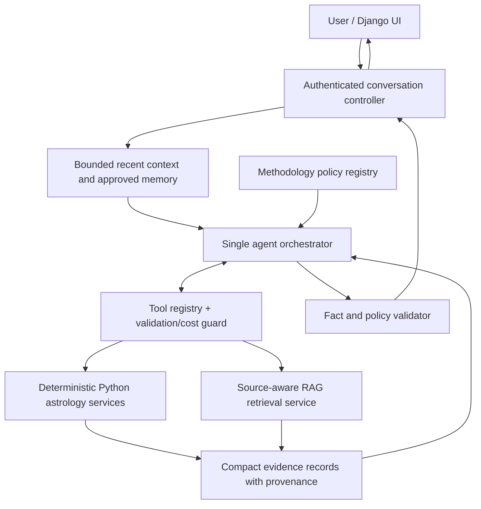

# AstroGPT — Claude Code Architecture Handover

**Status:** Architecture review only; no implementation authorized.  
**Owner:** Product owner / human astrologer  
**Implementer:** Claude Code  
**Guiding principle:** Keep the deterministic calculations; replace the rigid evidence-dump → single LLM interpretation with bounded, iterative reasoning over compact calculation tools and curated source retrieval.

## 1. Business outcome

Build a commercially viable, conversational Vedic astrology product for consumers, with the option of astrologer-led B2B2C distribution. The user enters birth details once, asks natural questions, and receives context-aware interpretations. The agent may search astrological source literature and request further precise calculations, while server-side controls enforce correctness, authorization, privacy, reliability and costs. Avoid presenting astrological convergence as validated statistical probability.

### Current, observed issues to verify—not assume repaired

- Live Django traffic was reported to use the **legacy** evidence-to-LLM pipeline, not the new agent, despite P1–P8 implementation claims.
- A diagnostic reported about **101,573 estimated prompt tokens** on one request; this figure must be measured and attributed at the actual provider boundary.
- OpenAI requests timed out; diagnostic found IPv6 attempts failing while IPv4 connected quickly. Verify current configuration and a small live API call before conducting paid tests; do not disable IPv6 globally.
- A follow-up checkbox / message-number UI makes contextual conversation manual. In-conversation context should be automatic subject to user privacy settings.
- Hosted OpenAI `file_search` is in use. The source PDFs are controlled by the owner, but indexing, retrieval quality and attached-file status must be verified independently.
- Source notes and Phase 1 planning documents may be older snapshots. **Do not treat P1–P8 completion statements, the initial 70-test baseline, or architectural prose as proof of the current running code.**

## 2. Inputs Claude must read and verify

1. Current working-tree code, git status/branches, README, `AGENTS.md` and application settings (without printing secrets).
2. `ASTROGPT_ARCHITECTURE.md` — historical AS-IS snapshot; verify against current source.
3. `ASTROGPT_AGENT_RESTRUCTURING_MASTER_PLAN.md` — original P1–P8 intended scope, if present.
4. All available `PHASE_*` plans, completion/test reports and `POST_P8_*` diagnostics.
5. `OPENAI_TIMEOUT_DIAGNOSTIC.md`, if present.
6. `architecture_todo.md`, `divisional_source_notes.md`, `jaimini_source_notes.md`, `parashari_source_notes.md`, `yogini_ocr_task.md`, if present.
7. `user_question_flow.pdf`, if available, as a historical flow, not proof of present routing.
8. The actual local astrology source documents, metadata and corpus inventory if accessible. **Never reproduce copyrighted source passages in reports.**

If a named file is missing, report `NOT FOUND` rather than inventing its contents. All findings need source file/function references and a distinction between `CONFIRMED`, `INFERRED`, and `UNVERIFIED`.

## 3. Architecture principles already agreed

### Division of responsibilities

- **Django/application controller:** Authentication, chart ownership, sessions, consent, costs, quotas, timeouts, observability, durable state and secure tool dispatch.
- **One reasoning agent:** Identifies question type, target person, time scope and investigative hypotheses; selects among authorized tools; interprets retrieved principles and computed facts; may request another focused round; stops within policy/budget limits.
- **Deterministic Python services:** The *only* authority for chart positions, Vargas, house/lord/aspect relationships, dashas, transit positions, Ashtakavarga and deterministic yoga/rule facts. No arbitrary model-generated Python execution.
- **RAG service:** Search relevant excerpts and exceptions in full source PDFs and reviewed notes, with source identity, location and retrieval diagnostics. The RAG service retrieves; the agent decides how to use the results.
- **Methodology policy:** A compact, versioned, human-approved guide to minimum evidence for **question type + domain + time horizon**, not rigid `career => calculate everything`. Policies guide investigations, not outcomes.
- **Evidence and validation:** Separate calculated facts from interpretive claims, preserve provenance and unresolved differences, detect invented numerical facts, and express uncertainty without false numerical odds.
- **Provider adapters:** Keep calculation and knowledge layers independent of any model provider. OpenAI may remain the first LLM backend; provider switch should not require rewrites of astrology logic.

### RAG design

The initial OpenAI vector store contains seven astrology PDFs following the user's attachment update; **verify the relevant store and searchable status via actual configuration/retrieval tests**. Original PDFs need not be manually converted to Markdown. Use reviewed Markdown for high-value methodology/exception notes only. Future independent RAG may parse PDFs into chunks and embed/index them (e.g., PostgreSQL plus pgvector, subject to benchmarking), preserving source/page/section metadata. Do not assume uploaded PDFs are correctly indexed or rights-cleared for commercial reuse.

### MCP versus Python

Design tool inputs/outputs as typed, compact, reusable contracts. **Call Python services directly from the Django agent first.** Add an MCP/REST adapter only if an external consumer needs it. Avoid an MCP server per chart/divisional calculation and avoid unnecessary network hops.

### Human astrologer's first methodology example: career

1. Determine **relevant-period** Vimshottari MD/AD (not only the current date).
2. Inspect MD/AD-lord connections to D1 houses 1, 5, 6, 8, 10, 11 and where relevant 12. Evaluate *lordship, placement, aspects and condition*, including contextual functional beneficence; no universal fixed planetary label.
3. Distinguish potential events using interpretive patterns, **not exact-match guarantees**: 1/6/10/11 promotion; add 5 for voluntary employer change; add 8 for disruption/lateral possibilities; 8th lord affecting 10th may support involuntary change; add 12 for foreign dimension. These are user-specified heuristics, not scientific probabilities or automatic certainties.
4. Confirm professional context through D10, then investigate Chara Dasha/Amatyakaraka and Jaimini aspects; Yogini may add corroboration or conflict. `Neutral`, `contradictory` and `unavailable` must remain different states.
5. Examine relevant MD/AD lord transits in date segments, attaching natal-sign SAV values. User's heuristic: SAV above 28 is supportive of the **planet's capacity to deliver its own indicated results**, not proof of favorable career outcome. Examine 10th lord transit/SAV and Jupiter's aspect to the 10th; Jupiter's transit carries greater weight when Jupiter is an MD/AD lord, otherwise remains secondary.
6. Agent compares support, pressure and shared roots across systems; it must not double-count dependent indicators or turn convergence scores into percent odds.

The career policy is a **worked example**, not an instruction to apply D10 or all these checks to every simple factual career question. Other domains require later human review; do not extrapolate career-house rules to health, marriage or children.

### Example intended interaction

User: `Can I get a new job next year?`  
Controller resolves the user's authorized chart and the local-date meaning of `next year`. Agent asks for MD/AD timeline for that year and compact D1 relationships, retrieves relevant source guidance, requests D10 and/or Chara confirmation and selected transit/SAV segments, examines contradictory findings, optionally calls another tool, then answers naturally with uncertainty and references. A follow-up such as `What about Jupiter in Leo?` reuses recent conversation context and chart, retrieves only additional evidence and does not require a checkbox.

## 4. Critical questions Claude must resolve in audit

1. Which agent tools and orchestrator functions exist today, and which are actually reachable from the **live** Django view?
2. What exact payload crosses the LLM boundary? Measure component token counts and repeated tool/history context. Is 101,573 the submitted tokens or an estimator figure?
3. What are the genuine verified calculation contracts? Distinguish local snapshots from independent astronomical/method reference tests.
4. Which rules are duplicated (YAML/Python), and do they affect scoring more than once?
5. Are Dasha transition end dates consistent across event, periodic and report paths? Are missing facts represented as `unknown` instead of zero?
6. Does chart ownership hold for every tool call and follow-up, including forged IDs?
7. Does generation fail closed on provider timeout, unavailable RAG, unverified evidence and hard spending caps? Are failed answers unbilled?
8. Can the existing ingestion/vector-store sources be inventoried and retrieved? What is missing for provider-independent indexing and citation fidelity?
9. Can the agent distinguish factual lookup from predictive investigation so it avoids unnecessary RAG/LLM work?
10. Does automated conversational memory actually reach the model in the live follow-up route, and does it respect user memory controls?
11. What is the smallest measurable migration that gives a successful end-to-end tool call without changing the calculation engine?
12. Which calculation methods or source interpretations differ across traditions, and how will chosen methods be disclosed/versioned?

## 5. Initial architecture sketch (subject to review)

This is a target **logical architecture**; do not infer it is implemented.

## 6. Milestone-gated delivery model

See `ASTROGPT_CLAUDE_MILESTONE_TRACKER.md`. **Milestone M0 is audit/design only.** Stop after M0 for owner approval. No code, migrations, package additions, network/provider calls, credentials changes or refactors in M0. Once the design is approved, implement one milestone at a time, run focused plus regression tests, write a report, and wait for explicit approval before proceeding.

## 7. First message to Claude Code (copy/paste)

> You are taking over the AstroGPT Django project. We will **finalize architecture before coding**. Read `ASTROGPT_CLAUDE_ARCHITECTURE_HANDOVER.md` and `ASTROGPT_CLAUDE_MILESTONE_TRACKER.md` first, then inspect the repository and all available source/phase/diagnostic documents mentioned in the handover. **Do M0 only: independent current-state audit plus proposed architecture and milestone mapping. Do not modify application code, tests, dependencies, migrations, environment settings or provider configuration, and do not run paid external calls.** Produce `CLAUDE_AS_IS_VERIFICATION.md`, `CLAUDE_TO_BE_ARCHITECTURE_PROPOSAL.md`, and `CLAUDE_MILESTONE_GAP_MAP.md`. Include code/function evidence, precise unknowns, risk ranking, architecture alternatives with trade-offs, and questions needing product-owner decisions. Identify existing P1–P8 work that can be reused. Stop for approval. Never output secrets or private chart records.

M2 architecture constraint: AstroGPT currently has no infrastructure to host its own RAG. Use the existing OpenAI AstroVectorStore and seven attached astrology PDFs as the initial knowledge retrieval backend. Design the retrieval layer so it can be replaced later, but do not implement PostgreSQL pgvector, Qdrant, embedding pipelines or separate RAG servers. Prioritize agent-driven retrieval, deterministic calculations, conversational memory, source-grounded interpretation, and cost efficiency. Treat independent RAG infrastructure as a future option, not an MVP requirement.