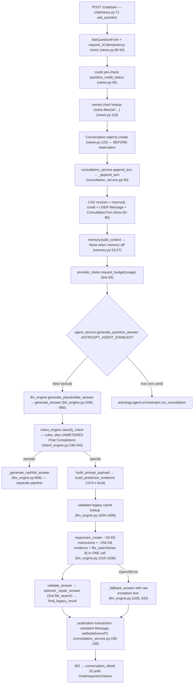

# AstroGPT — Independent AS-IS Verification (M0)

**Author:** Claude Code (independent audit)  
**Date:** 2026-11-10  
**Milestone:** M0 — architecture audit only. No production code, tests, database, dependencies, settings or provider configuration were changed. No network or paid provider calls were made.  
**Companion documents:** `CLAUDE_TO_BE_ARCHITECTURE_PROPOSAL.md`, `CLAUDE_MILESTONE_GAP_MAP.md`

---

## 0. Method and evidence labels

| Label | Meaning |
|---|---|
| **CONFIRMED** | Verified by reading the current working-tree source and/or executing a local, offline command during this audit. |
| **INFERRED** | Follows from confirmed source, but the runtime effect was not executed or measured. |
| **UNVERIFIED** | Claimed by a document, or depends on external state (provider, vector store, deployment) that this audit could not inspect. |
| **NOT FOUND** | Searched for and absent from the inspected workspace. |

**What was executed during this audit (all local, offline):**

- Read-only source inspection, `git status`/`git branch`/`git log`, file inventories.
- `manage.py test --noinput` on Django's **isolated test database**. Result: **308 tests, 0 failures, 0 errors, 172.3 s** (CONFIRMED). The tests block sockets and mock the provider, so this proves offline behaviour only.
- Filename/size inventory of local source PDFs. **No book content was opened or reproduced.**
- `.env` was inspected for **key names only**. No values were printed.

**What was not done:** no application-database queries or writes, no `migrate`, no provider/vector-store calls (including the free `vector_stores.files.list`), no browser session, no running-server inspection.

---

## 1. Executive summary — the ten findings that matter most

1. **CRITICAL: none of P1–P8 is committed.** All eight branches (`main`, `feature/*-p2` … `feature/pilot-release-p8`) point at the same commit `2312a42`. About 110 working-tree entries are modified or untracked, including 7 migrations, the entire `astrology/agent/`, `astrology/tools/`, `astrology/evaluation/` packages and all P7/P8 billing code. A single bad `git checkout`/`reset`/disk event loses the entire migration programme. *(CONFIRMED: `git branch -v`, `git status --short`)*
2. **Live traffic uses the legacy one-shot pipeline.** `ASTROGPT_AGENT_ENABLED` is absent from `.env`, so it defaults to `false` (`astro_site/settings.py:156`). `chat/agent_service.py:8-9` then routes every question to `generate_placeholder_answer` → `chat/llm_engine.py::generate_answer`, which **does not accept** the consultation context. *(CONFIRMED)*
3. **The "agent" is mostly a deterministic rules engine with a constrained LLM.** Question type, topic and dates are decided by **regex** (`astrology/agent/policy.py:31-98`). The LLM is only invoked for `assessment`/`timing` kinds (`orchestrator.py:270`), may only *add* allow-listed tool calls, and the final answer is assembled from **~10 hard-coded sentences plus verified fact slots** (`astrology/synthesis/verified_answer.py:10-40`). The LLM cannot interpret retrieved book passages or explain the chart in its own words. This contradicts the handover's target ("agent interprets… answers naturally"). *(CONFIRMED)*
4. **Topic coverage is very narrow.** Only career/business assessments are accepted; any other interpretive topic (marriage, health, children, education) raises `ScopeError` (`policy.py:92-93`). The only supported house-lord lookup is the **10th** (`policy.py:37`). "Who is my 7th lord?" falls through to an assessment with topic `general` and is rejected. *(CONFIRMED)*
5. **The 101,573-token figure is a local conservative estimate, not provider-reported usage.** It comes from `accounts/token_budget.py::input_token_bound()` (tiktoken count of the serialized request + 4,096-token allowance) on an offline replay. No full-size production request has completed at the provider, so actual submitted tokens are **UNVERIFIED**. *(CONFIRMED from `OPENAI_TIMEOUT_DIAGNOSTIC.md` §3 + source)*
6. **The agent's prompt grows every round.** `Consultation.investigate()` re-sends the *entire* cumulative evidence dict, trace and both catalogs on every model round (`orchestrator.py:204-209`), with a tool-byte allowance of 512 KiB (`orchestrator.py:29`). Its budget check uses a **byte** bound (`provider.py:48-51`), the same class of defect that caused the post-P8 incident in the legacy path. *(CONFIRMED source; runtime size UNVERIFIED — never measured)*
7. **Plan budgets and the agent loop are incompatible on the free plan.** The free policy allows **2 provider rounds and 1 file search** (`accounts/usage_policy.py:9`). Any call carrying `file_search` reserves the **full 128k context** as input (`provider_meter.py:38`) against a 160k free token cap. A typical agent timing consultation (planner round → search → finishing round) cannot complete on the free plan. Legacy repair also needs a second search, which the free policy rejects; the answer is then discarded as "spending limit". *(CONFIRMED source; INFERRED runtime)*
8. **Two paid OpenAI call sites bypass the P7 spending meter.** `chat/intent_engine.py:210-218` (Chat Completions on the **live** legacy path for ambiguous questions; SDK-default timeout of 600 s and 2 retries) and `charts/yearly_predictions.py:523-526` (direct `client.responses.create`). This contradicts P7's "single paid-call boundary" claim. *(CONFIRMED)*
9. **Conversational memory is manual and opt-in, and inactive in practice.** `memory_enabled` defaults to `False` (`chat/forms.py:19`, `chat/models.py:26`). Follow-ups expose "Corrected message number" and "Older message to include" integer fields (`chat/forms.py:27-28`, `templates/chat/ask.html:124-129`). Even with consent, context never reaches the model while the flag is off. *(CONFIRMED)*
10. **Retrieval works at the transport level, but corpus coverage is unknown.** One bounded synthetic probe on 2026-11-09 returned HTTP 200 with one file-search hit (`IPV4_TRANSPORT_FIX_REPORT.md`). Which files are in the store, their processing status, and whether they match the seven intended PDFs are all **UNVERIFIED**. One referenced source, `Yogini Dasha.pdf`, is **NOT FOUND** locally.

---

## 2. Repository and version-control state

| Item | Finding | Status |
|---|---|---|
| Current branch | `feature/pilot-release-p8` (the session-start snapshot said `main`) | CONFIRMED |
| Branch heads | All 8 local branches = `2312a42 "3-Jun-2026"` | CONFIRMED |
| Uncommitted footprint | 41 tracked files modified (+1,168 / −212 lines); ~70 untracked paths including `astrology/agent/`, `astrology/tools/`, `astrology/evaluation/`, `chat/consultation_service.py`, `chat/memory.py`, `accounts/usage.py`, `accounts/provider_meter.py`, 7 migrations, all `docs/agent_migration/` reports | CONFIRMED |
| Remotes | `origin/main`, `origin/master`; P1–P8 has never been pushed | CONFIRMED |
| Secrets in git | `.env` and `db.sqlite3` are git-ignored and not tracked | CONFIRMED |
| Line endings | Git warns LF→CRLF on most modified files; this will produce noisy diffs on the first commit | CONFIRMED |
| Phase report claims of "branch: feature/…-pN" | Misleading: branches were created but nothing was committed to them | CONFIRMED |

**Consequence:** the phase reports' rollback instructions ("remove/revert the files listed") cannot be executed via git. There is no per-phase history to bisect regressions against.

---

## 3. Input document inventory

| Document (handover §2) | Present? | Use in this audit |
|---|---|---|
| `ASTROGPT_CLAUDE_ARCHITECTURE_HANDOVER.md`, `ASTROGPT_CLAUDE_MILESTONE_TRACKER.md` | Yes | Read completely |
| `README.md`, `AGENTS.md`, `astro_site/settings.py` | Yes | Read (settings: key names only) |
| `ASTROGPT_ARCHITECTURE.md` (7 Nov AS-IS snapshot) | Yes | Read; its claims were re-checked below |
| `ASTROGPT_AGENT_RESTRUCTURING_MASTER_PLAN.md` | Yes | Read completely |
| `PHASE_01_PLAN.md` | Yes (repo root, not `docs/agent_migration/`) | Skimmed |
| **`PHASE_01_TEST_REPORT.md`** | **NOT FOUND** | P1's "70-test baseline" is asserted only inside the P2 report |
| `docs/agent_migration/PHASE_02…08_*` (plans, contracts, test reports, runbook) | Yes, 23 files | Test reports read completely |
| `POST_P8_RUNTIME_FAILURE_REPORT.md`, `OPENAI_TIMEOUT_DIAGNOSTIC.md`, `IPV4_TRANSPORT_FIX_REPORT.md` | Yes | Read completely |
| `TOOL_CONTRACTS.md`, `KNOWLEDGE_TOOL_CONTRACTS.md` | Yes | Referenced |
| `astrology/docs/architecture_todo.md`, `divisional_source_notes.md`, `jaimini_source_notes.md`, `parashari_source_notes.md`, `yogini_ocr_task.md` | Yes | Headings/filenames only (source notes) |
| `astrology/docs/user_question_flow.pdf` | Yes (tracked) | Not relied upon: historical flow only |
| Local source PDFs | Partially (see §11) | Filenames and sizes only |

---

## 4. Live Django request routing (CONFIRMED)

### 4.1 Actual path for a new question today

### 4.2 Follow-up path

`POST /chat/conversations/<id>/followup/` → `chat/views.py:203 conversation_followup` → the same `append_turn(...)`. With the flag off, the follow-up is answered as an **independent** legacy question. The template correctly says so (`templates/chat/ask.html:119-120`).

### 4.3 Routed URL inventory

| Prefix | Routes (source) | Notes |
|---|---|---|
| `/` | `home` (`astro_site/urls.py`) | |
| `/chat/` | `ask`, `history`, `ask/history/<id>`, `conversations/<id>/followup|memory|memory/action`, `requests/<uuid>/status`, `answers/<id>/evidence|feedback` (`chat/urls.py`) | All `@login_required`; ownership enforced per view |
| `/charts/` | list, new, delete, birth-place suggestions (`charts/urls.py`) | **Report/PDF views exist but are unrouted** (`charts/views.py:192, 206`) |
| `/accounts/` | dashboard, start, privacy/delete, contribution, pilot/analytics | Last two superuser-only per P7/P8 |
| `/payments/webhook/` | `webhook_placeholder` returns static text (`payments/views.py:4`) | No gateway integration |
| `/admin/`, `/auth/`, `/login/`, `/logout/`, `/password-reset/` | Django admin (operator-only per P8), allauth | |

### 4.4 Fallback paths

| Trigger | Behaviour | Status |
|---|---|---|
| Flag off | Legacy only; the agent is never tried | CONFIRMED (`agent_service.py:8-9`) |
| Agent failure (flag on) | No automatic legacy retry | CONFIRMED |
| Legacy `OpenAIError` | `_fallback_answer` text, **including `str(exc)`**, is stored as an assistant message and settled `partial_free` (no credit consumed) | CONFIRMED (`llm_engine.py:1038`; `consultation_service.py:122-135`) |
| Legacy validation fails after repair | `final_legacy_result` marks it failed; `_append_turn` replaces it with an error; no message is stored | CONFIRMED (`consultation_service.py:99-101`) |
| `BudgetExceeded` anywhere | Error text, no assistant message, credit released | CONFIRMED (`consultation_service.py:102-103`) |

---

## 5. P1–P8 claims versus current source

Legend: **implemented** (code exists and is reachable live) · **disconnected** (code exists and is tested but not reachable by live traffic) · **partial** · **missing** · **unverified** (depends on external state).

| Phase | Claimed deliverable | Verdict | Evidence |
|---|---|---|---|
| P1 | Baseline + independent reference fixtures | **partial / unverified** | No `PHASE_01_TEST_REPORT.md`. P2–P8 reports state that independent numerical oracles were never produced. Snapshot/legacy-parity tests only. |
| P2 | Six typed deterministic tools, owner-scoped, cached | **implemented but disconnected** | `astrology/tools/registry.py:26-34`, `invoke_tool` at `:47`. Only the agent calls it. |
| P3 | Bounded agent orchestrator | **disconnected** | `astrology/agent/orchestrator.py`; only reachable when the flag is true. The planner is regex-based (§6). |
| P3 | Unavailable-chart guard at the view | **implemented (live)** | `chat/views.py:118-121` |
| P4 | Targeted knowledge tool + replaceable adapter | **disconnected**; live corpus **unverified** | `astrology/rag/knowledge.py`, `hosted.py`, protocol at `knowledge_contracts.py:32` |
| P5 | Follow-up route, consent, CAS, deletion | **implemented (live)** | `chat/views.py:203-250`, `consultation_service.py` |
| P5 | Context reaching the model | **disconnected** | `build_context` output is dropped on the legacy path (`agent_service.py:9`) |
| P6 | Fact catalog + claim validator + controlled composition | **disconnected** for the agent | `fact_catalog.py`, `claim_validator.py`, `verified_answer.py` |
| P6 | Legacy final validation / no failed-answer cache | **implemented (live)** | `chat/publication.py`, `llm_engine.py:1084-1087` |
| P6 | Blinded human evaluation | **missing** | P6 report: zero human votes; gate BLOCKED |
| P7 | Transactional credits, idempotency, provider meter | **implemented (live)**, with gaps | `accounts/usage.py`, `provider_meter.py`. Two unmetered call sites (§9.2). |
| P7 | Live average/P95 cost | **missing** | P7 gate BLOCKED |
| P8 | Progress/status polling, hardened settings profile, admin restriction, account deletion, rate limits | **implemented (live, offline-tested)** | `astro_site/production.py`, `pilot_middleware.py`, `accounts/pilot_ops.py` |
| P8 | Applied migrations, staging, real browser/SMTP | **missing / unverified** | P8 report: `migrations_current:false` on the app DB at that time; current state not re-checked (no DB access in M0) |
| Post-P8 | Token-based context guard; Yogini scope compaction | **implemented (live)** | `accounts/token_budget.py`, `llm_engine.py::_compact_live_evidence` |
| Post-P8 | IPv4-bound transport | **implemented (live)** | `accounts/provider_transport.py::IPv4HttpClient`, used at all 6 client sites |

**Test count claim:** the latest report claims 308 passing tests. This audit's independent run reproduced **308 passed, 0 failed** (CONFIRMED). Many tests compare against the code's own legacy outputs, so they protect against regressions but do not prove correctness.

---

## 6. Agent and tool inventory

### 6.1 Tools (all CONFIRMED in source)

| Tool | Adapter | Owner check | Notes |
|---|---|---|---|
| `get_chart_facts` | `tools/adapters.py` | `registry.py:60` (every call, including cache hits) | Stored chart data only; no regeneration |
| `get_dasha_periods` | ″ | ″ | Vimshottari / Yogini / Chara; half-open `[start,end)` source periods (`adapters.py:80`) |
| `get_transits` | ″ | ″ + requires natal | Daily 12:00 UTC sampling (`adapters.py:117`) |
| `get_ashtakavarga` | ″ | ″ | Missing → null, real zero stays zero (P2 tests) |
| `evaluate_astrology_rules` | ″ | ″ | Rebuilds most legacy evidence stages (chart facts, dasha, Parashari, varga, transit) for one `as_of` date, then runs the legacy rule engines (`tools/adapters.py:147-190`). Uses the **inclusive-end** `build_dasha_facts`, so one agent request mixes both dasha conventions (§8.3). The most expensive tool (~0.65 s rule engine alone). |
| `get_timing_candidates` | ″ | ″ | Legacy timing selector; heuristic scores |
| `search_astrology_knowledge` | `rag/knowledge.py` → `rag/hosted.py` | `KnowledgeSession` | One Responses call with forced `file_search` per search |

The allowlist is immutable (`orchestrator.py:21`, `registry.py:26`). `chart_id` is overwritten server-side (`orchestrator.py:73-75`). There is no arbitrary code execution, no writes, and no dynamic imports (CONFIRMED).

### 6.2 What the orchestrator actually does

| Stage | Who decides | Source |
|---|---|---|
| Question kind (house_lord, current_dasha, dasha_lookup, planet_position, ashtakavarga_lookup, transit, timing, assessment) | **Regex** | `policy.py:37-52` |
| Topic (`job`/`business`/`general`) | **Keyword match** | `policy.py:53` |
| Date window ("next year", named months, ISO dates; default today + 1,095 days) | **Regex** | `policy.py:54-84` |
| Minimum evidence sequence | **Fixed code** | `orchestrator.py:152-196` |
| Optional extra tools | LLM proposes; server validates scope | `orchestrator.py:78-97, 198-260` |
| Final prose | **Server**: canned narrative IDs + fact slots chosen by the LLM | `verified_answer.py:10-40, 83+` |

The default limits are 4 rounds, 24 calls, 512 KiB of tool output, 100,000 model tokens, 60 s total and 15 s per tool (`orchestrator.py:26-34`). Only cooperative deadlines are enforced; synchronous helpers cannot be pre-empted (P3 report, CONFIRMED by design).

---

## 7. What crosses the LLM boundary (handover Q2)

### 7.1 Legacy path (live)

| Component | Size | Source |
|---|---|---|
| Instructions `_system_instructions` | ≈33 KB, including many unrelated question-category blocks | `llm_engine.py:60-480`; diagnostic §4 |
| Evidence payload (post-compaction) | ≈255,850 bytes; largest parts Jaimini ≈88 KB, timing ≈44 KB, transits ≈41 KB, rules ≈25 KB (40 rules) | diagnostic §4 |
| Serialized request | ≈319.5 KB | diagnostic §3 |
| **Token figure** | **101,573 = local conservative estimate** (tiktoken + 4,096 allowance), not provider-reported | `token_budget.py`; diagnostic §3 |
| Conversation history | **None** | legacy ignores context |
| Hosted file_search | Up to 8 chunks, injected by the provider; size invisible to the app | `llm_engine.py:1031-1034` |

**Answer to Q2:** 101,573 is an **estimator upper bound** computed offline. No full-size legacy request has ever returned provider-reported usage. The only provider-reported numbers come from two tiny synthetic probes (12 and 2,073 input tokens). (CONFIRMED)

### 7.2 Agent path (disconnected)

Per round: `{question, plan, evidence (ALL tool results so far, raw), trace, remaining_calls, answer_catalog, narrative_catalog, consultation_context}` plus 7 function schemas, instructions and the final JSON schema (`orchestrator.py:204-209`; `provider.py:57-63`). The payload is **cumulative**, so round *n* re-sends rounds 1…n−1. `evaluate_astrology_rules` alone returns the same broad legacy rule evidence. **No measurement exists** (UNVERIFIED). The design risks rebuilding the 100k-token problem inside the agent.

---

## 8. Calculation services, methods and test status (handover Q3, Q12)

### 8.1 Method choices found in source

| Choice | Value | Source | Disclosed to user? |
|---|---|---|---|
| Ayanamsa | Lahiri | `charts/astro_engine.py:352` | Tool `method.reference_frame` only |
| Ephemeris | Swiss Ephemeris flag `FLG_SWIEPH`, **no `set_ephe_path`** in the repo → likely falls back to built-in Moshier | `astro_engine.py:360` | No (INFERRED fallback) |
| Lunar node | True node | `astro_engine.py:36` | No |
| Houses | Whole-sign from Lagna; `houses_ex(…, b"P")` used only for the ascendant | `astro_engine.py:361, 376` | Partially |
| Dasha year length | 365.2425 days | `vimshottari.py:16`, `yogini.py:81` | No |
| Transit resolution | Daily 12:00 UTC samples; no exact ingress instants | `tools/adapters.py:106-117` | Yes (tool metadata) |
| Invalid timezone | Silent fallback to UTC | `astro_engine.py:57-59` (P8 added form validation upstream) | No |
| Chart template version | Engine emits `…v10_shodashvarga`; refresh check expects `…v9_d4_extra_vargas` | `astro_engine.py:406` vs `charts/views.py:98` | — |

### 8.2 Verification status of calculations

- **No independent reference fixtures** (published ephemeris tables, reference software outputs) were found. P2's "PASS for compatibility" explicitly compares new wrappers against legacy outputs (CONFIRMED in report; no oracle fixture files found).
- The P6 evaluation fixture (`astrology/evaluation/fixtures/p6_cases_v1.json`) uses one synthetic natal chart and validates that answers match **tool output**, not astronomical truth.
- **Answer to Q3:** the "verified calculation contracts" are interface contracts (schemas, ownership, bounds). Numerical correctness is **UNVERIFIED** against any external reference.

### 8.3 Dasha boundary consistency (handover Q5) — CONFIRMED inconsistent

| Convention | Call sites |
|---|---|
| **Inclusive end** `start <= d <= end` (on a transition day the *old* period matches first) | `astrology/calculations/dasha_facts.py:26`, `astrology/calculations/yogini.py:88`, `charts/yogini_alignment.py:26`, `charts/jaimini_confirmation.py:52`, `chat/rashifal_context.py:66`, `chat/prediction_context.py:899`, `chat/timing_windows.py:344` |
| **Half-open** `[start, end)` | `astrology/calculations/dasha_transit_timeline.py:3-4`, `astrology/tools/adapters.py:71-80` |

On the exact transition date, the event-question rule evidence, the periodic reading and the yearly report can name a different MD/AD than the agent tools. Missing values: the tools return `null`/`unknown` for missing SAV; legacy timing scores still contain missing-score fallbacks (P2 report §limitations; not re-derived here).

---

## 9. Rules, scoring and cost controls

### 9.1 Rule duplication (handover Q4)

- 223 YAML rules across 7 files (CONFIRMED by count; no duplicate IDs inside YAML).
- `build_prediction_evidence` concatenates YAML results with **ten** Python evaluator families: generic varga, D1, D2, D3, D4, D7, D9, D10, D12, D16 (`astrology/services/prediction_service.py:152-163`).
- `aggregate_scores` adds `value × weight` for every triggered rule with **no deduplication** and clamps to 0–100 (`astrology/rules/scoring.py:10-20`). YAML `divisional_rules.yaml` (82 rules) and `d10_dashamsha_rules.py` both encode D10 factors, so stacking is likely (INFERRED; a semantic overlap check was not performed). The clamp means outcomes saturate quickly, which flattens discrimination.
- Rule validation remains advisory: invalid rules are still appended (historical doc §7.1; not re-tested).

### 9.2 Spending and billing (handover Q7)

| Control | Status | Source |
|---|---|---|
| Per-request round/token/search/cost ceiling | Implemented for `responses_create` callers | `provider_meter.py:27-61` |
| Daily per-user provider cap ($1.00 default) | Implemented | `provider_meter.py:47-53` |
| Pre-dispatch persisted liability row | Implemented | `provider_meter.py:55-58` |
| Failed/partial answers do not consume credit | Implemented: `delivered` requires `status=='ok'`, `validation.passed`, `stop_reason=='complete'` | `consultation_service.py:132-135` |
| **Unmetered call: intent classifier** | **Gap (live path)**: no budget, SDK default timeout/retries, no ledger row | `chat/intent_engine.py:210-218` |
| **Unmetered call: yearly predictions** | **Gap, currently unreachable**: only called via `_report_payload` from the unrouted `chart_report`/`chart_report_pdf` views (`charts/views.py:202, 216`). It becomes live the moment report routes are restored. | `charts/yearly_predictions.py:523-526` |
| file_search reservation | Reserves the **full model context** (128k) per call | `provider_meter.py:38` |
| Only priced model | `gpt-4o-mini`; any other model fails closed (`unpriced_model`) | `usage_policy.py:5-7` |
| Hard organisation-level provider cap | Not implemented (P7 notes) | — |

---

## 10. Chart ownership and access isolation (handover Q6)

| Boundary | Check | Status |
|---|---|---|
| Ask view chart selection | `charts.filter(id=chart_id)` scoped to `request.user` | CONFIRMED `views.py:72, 118` |
| Conversation access | `owned_conversation` filters by `user_id`; re-checks chart owner | CONFIRMED `consultation_service.py:29-37` |
| Follow-up chart override | Rejected with 409 | CONFIRMED `views.py:205-206` |
| Every tool call | Fresh `SavedChart` owner query, including cache hits; no staff bypass | CONFIRMED `registry.py:60` |
| Agent arguments | `chart_id` forced to the session chart | CONFIRMED `orchestrator.py:73-75` |
| Ownership change mid-request | Evidence discarded before publication | CONFIRMED `orchestrator.py:278-282`; `consultation_service.py:112-114` |
| Status/evidence/feedback endpoints | Scoped to `request.user` | CONFIRMED `views.py:28-66` |

**Answer to Q6:** source inspection finds the ownership boundary consistently enforced, including for forged IDs. A-06 is covered by existing P2/P5/P8 tests (passing). One minor defect: `ask_question` creates the `Conversation` **before** the credit reservation (`views.py:125` vs `consultation_service.py:72`), so a reservation failure leaves an empty owned conversation. This is not a leak.

---

## 11. RAG dependencies and corpus (handover Q8)

### 11.1 Integration points

| Path | Mechanism | Retrieval control | Provenance retained |
|---|---|---|---|
| Legacy event answer (live) | `file_search` tool inside the synthesis call, `max_num_results=8` | **Model decides** whether and what to search; the app's `rag_context_request` query is only a hint | No: `retrieved_sources` is never populated |
| Legacy repair | Second `file_search` | Same | No |
| Legacy rashifal (live) | `file_search`, `max_num_results=6` | Same | No |
| Agent `search_astrology_knowledge` (disconnected) | Separate Responses call, forced `file_search`, `include=['file_search_call.results']`, `max_tool_calls=1` | App builds the query; snippets bounded to 1,200 B each and 6,000 B total | Yes: file IDs, attributes, evidence hashes |

The adapter boundary `RetrievalAdapter` (`knowledge_contracts.py:32-37`) is already vendor-neutral and reusable. The installed SDK (`openai 1.109.1`) also exposes direct `vector_stores.search` (`.venv/.../vector_stores.py:331`), which returns ranked chunks **without an LLM generation round-trip**. It is not used today (CONFIRMED present in SDK; pricing/behaviour UNVERIFIED).

### 11.2 Local corpus inventory (filenames/sizes only)

| Local file (parent folder `Astrology GPT/`) | Size | Notes |
|---|---:|---|
| `250256424-Astrology-at-the-Speed-of-Light-pdf.pdf` | 48.5 MB | Referenced in source notes |
| `predicting-through-jaimini-chara-dasha.pdf` | 20.5 MB | Referenced |
| `vargas-vedic-approach.pdf` | 14.2 MB | |
| `conjunctions___the_speed_of_light.pdf` | 4.5 MB | Referenced |
| `Book. Bhrigu Samhita T.M.Rao_text (1).pdf` | 3.7 MB | Referenced |
| `300 Astrology Yoga _ 300 Astrology Combinations _ Astrotalk.pdf` | 2.5 MB | Appears to be a capture of a commercial website: **rights risk** |
| `Yogini Dasha.pdf` | — | **NOT FOUND** locally (referenced 4× in `yogini_ocr_task.md`) |
| `Jyotish/Charts_Divisional/D1…D60.pdf` | 22 files, 1.4–7.3 MB | Not referenced by notes; unknown whether hosted |
| `Jyotish/*_abbyy.gz/.xml` | 14 OCR archives of other books | Unknown whether hosted |
| `.docx` working notes (4 files) | | Owner methodology notes; not inspected |

**Seven hosted PDFs:** the handover says seven are attached. The six top-level PDFs plus `Yogini Dasha.pdf` would make seven, but this is a **guess** (UNVERIFIED). Store contents, processing status, chunking and page metadata require a provider listing call, which was deliberately not made in M0.

### 11.3 Retrieval quality risks

1. Scanned/OCR PDFs (e.g. the 217-page Yogini text) may index poorly; hosted chunking hides page numbers unless the provider attaches them.
2. Hosted `file_search` attributes carry only what was set at upload; book/chapter/page are usually absent, so citations will often be "document only".
3. The legacy path cannot prove what was retrieved, so citation fidelity is zero today.
4. Commercial reuse rights of the PDFs are unreviewed (handover §3 RAG design).

---

## 12. Conversational memory (handover Q10)

| Aspect | Current behaviour | Source |
|---|---|---|
| Consent | Opt-in checkbox on the first question; default **off**; existing rows off | `forms.py:19`, `models.py:26` |
| Effect when off | `build_context` returns `None`; nothing is sent | `memory.py:54-57` |
| Effect when on, flag off | Context is built, then **discarded** by the legacy router | `agent_service.py:8-9` |
| Effect when on, flag on | Last 3 turns (≤6 messages, 640 B each), deterministic summary ≤4 KB, total ≤12 KB | `memory.py:7-11, 53-78` |
| References | User must type message numbers for corrections/older context | `forms.py:27-28` |
| Topic retention | Summary topic limited to `job`/`business`/`general` | `memory.py:34` |
| Elliptical follow-ups | Regex-only (`"what about d10"`, "late YYYY", "compare") | `continuity.py:115-150` |
| Controls | View, reset, disable, clear history, delete: all CSRF POST with revision CAS | `consultation_service.py:160-194` |

**Answer to Q10:** memory does **not** reach the model in the live follow-up route. When enabled, it is bounded and respects reset and delete. It is not automatic, and the reference UX is manual.

---

## 13. Fail-closed behaviour (handover Q7)

| Failure | Legacy (live) | Agent (disconnected) |
|---|---|---|
| Provider timeout / connection error | Fallback text **with raw exception string** stored as an assistant message; credit not consumed | `Stop('provider_timeout'/'provider_unavailable')` → deterministic evidence report, `partial`; credit not consumed |
| RAG empty / unavailable | Model answers without book support; not detectable | "No classical support was retrieved" narrative |
| Unverified evidence / invalid draft | Final validation blocks publication; repair requires a 2nd search, which free plan rejects | Server fallback composition; draft rejected |
| Spending cap | `BudgetExceeded` → error, no answer | `Stop('spending_limit')` → partial |
| Unsupported topic | Legacy still answers (broad evidence) | `ScopeError` → clarification request |

---

## 14. Performance problems

| # | Problem | Evidence | Status |
|---|---|---|---|
| P-1 | One huge synchronous LLM call (≈100k tokens est.) in the web worker; no streaming | §7.1 | CONFIRMED source |
| P-2 | Deterministic evidence build ≈0.88 s per question (rule engine 0.65 s, transits 0.18 s), recomputed **before** the cache lookup | diagnostic §2; `llm_engine.py:991-1009` | CONFIRMED |
| P-3 | `GET /charts/` recalculates and saves **every** chart on every visit (v9/v10 template mismatch) | `charts/views.py:98, 135-139`; `astro_engine.py:406` | CONFIRMED source |
| P-4 | A new OpenAI client/httpx stack per call (~1.2 s measured construction incl. import) | `provider.py:55`, `hosted.py:23`, `llm_engine.py:1011` | CONFIRMED source; timing from diagnostic |
| P-5 | Each knowledge search is a full LLM round-trip, plus a full-context cost reservation | `hosted.py:25-33`; `provider_meter.py:38` | CONFIRMED |
| P-6 | Agent payload is cumulative per round | §7.2 | CONFIRMED source; size unmeasured |
| P-7 | LocMem cache in development; per-process, so worker caches diverge | settings (no `CACHES` in dev) | CONFIRMED |
| P-8 | `evaluate_astrology_rules` tool rebuilds most legacy evidence stages per call | `tools/adapters.py:147-190` | CONFIRMED |
| P-9 | Default 3-year scan for unspecified timing questions can exhaust budgets | `policy.py:84`; P3 report | CONFIRMED |

---

## 15. Security and privacy risks (ranked)

| Rank | Risk | Evidence | Status |
|---|---|---|---|
| S-1 (Critical, operational) | Uncommitted P1–P8 code: no backup/history; also no reviewable diff for security changes | §2 | CONFIRMED |
| S-2 (High) | Raw `OpenAIError` text persisted into assistant messages shown to users (may include request IDs, org/project hints, error bodies) | `llm_engine.py:1038, 960` → `_fallback_answer` | CONFIRMED |
| S-3 (High) | Question text logged at INFO by the intent classifier; the exception is also logged with `%s` | `intent_engine.py:226, 230` | CONFIRMED; contradicts P8's payload-free logging claim |
| S-4 (High, cost) | Unmetered paid calls (intent classifier with SDK-default 600 s timeout and 2 retries; yearly predictions) | §9.2 | CONFIRMED |
| S-5 (Medium) | Development defaults: `SECRET_KEY="dev-only-change-me"`, `DEBUG` default `True` | `settings.py:12-13` | CONFIRMED; mitigated only if `astro_site.production` is used |
| S-6 (Medium) | Book passages enter prompts as untrusted text; the agent labels them, but legacy injects hosted chunks directly | `llm_engine.py` file_search | CONFIRMED design |
| S-7 (Medium) | Source-rights exposure (web-captured PDF; unreviewed book licences) if passages are shown to paying users | §11.2 | INFERRED |
| S-8 (Low) | Payment webhook placeholder accepts any method and returns 200 text on GET | `payments/views.py:4` | CONFIRMED |
| S-9 (Low) | Empty conversation created before credit reservation | §10 | CONFIRMED |
| S-10 (Low) | `select_for_update` is a no-op on SQLite; concurrency guarantees depend on PostgreSQL in production | `consultation_service.py:61` | CONFIRMED (P7 notes) |

---

## 16. Direct answers to the handover's 12 critical questions

| # | Question | Answer |
|---|---|---|
| 1 | Which agent tools/orchestrator functions exist and which are live? | 7 tools + `Consultation.run/minimal_evidence/execute/investigate` exist. **None are reachable live**: flag is off. Live = `chat/llm_engine.py::generate_answer`. |
| 2 | Exact payload / is 101,573 submitted tokens? | §7. **Local estimator**, not submitted. Instructions ≈33 KB + evidence ≈256 KB + hosted chunks. |
| 3 | Genuine verified calculation contracts? | Interface contracts are verified offline; **numerical correctness has no independent reference fixtures**. |
| 4 | Duplicated rules / double scoring? | YAML + 10 Python evaluator families concatenated; `aggregate_scores` has no dedup. Overlap likely (INFERRED). |
| 5 | Dasha end dates consistent? Missing as unknown? | **Not consistent** (§8.3). Tools use null for missing; legacy scoring has fallbacks. |
| 6 | Ownership for every tool call and follow-up? | **Yes**, per source and passing tests (§10). |
| 7 | Fail closed on timeout/RAG/evidence/caps; failed answers unbilled? | Mostly unbilled (CONFIRMED). Not fully fail-closed: legacy fallback stores raw error text; unmetered calls exist (§13, §9.2). |
| 8 | Corpus inventory/retrieval? Gaps for independence? | Local inventory done (§11.2); hosted inventory **UNVERIFIED**. Adapter protocol exists; missing: manifest, page metadata, citation tests. |
| 9 | Factual vs predictive distinction? | Yes, for a narrow regex set (10th lord, current dasha, positions, SAV). Factual lookups make **zero** LLM calls (CONFIRMED). Broader factual questions are rejected. |
| 10 | Memory reaches model live? Respects controls? | **No** (flag off). Controls are implemented and respected. |
| 11 | Smallest measurable migration? | Enable the agent for **one operator account** for factual + one career question, behind a per-user flag, with the free-plan policy raised for that account and per-round payload compaction. See TO-BE §10. |
| 12 | Tradition/method differences and disclosure? | §8.1: Lahiri, true node, whole-sign, 365.2425-day years, noon-UTC sampling. These are recorded only in tool metadata, not shown to users, and not versioned as a "method profile". |

---

## 17. Precise unknowns (cannot be resolved in M0 without approval)

1. Hosted vector-store file list, processing status, chunking and attributes (needs a provider listing call; the listing is not a model call, but it is a provider call).
2. Real provider-reported tokens and latency for a full legacy or agent request (needs a paid call).
3. Whether the running dev server has reloaded the post-P8 code and `tiktoken` vocabulary (no process inspection).
4. Current applied-migration state of `db.sqlite3` (not queried).
5. Whether Swiss Ephemeris data files exist anywhere on the deployment host (affects precision disclosure).
6. Semantic overlap between YAML D10 rules and `d10_dashamsha_rules.py` (needs a rule-by-rule review by the astrologer).
7. Licensing terms of each source PDF.
