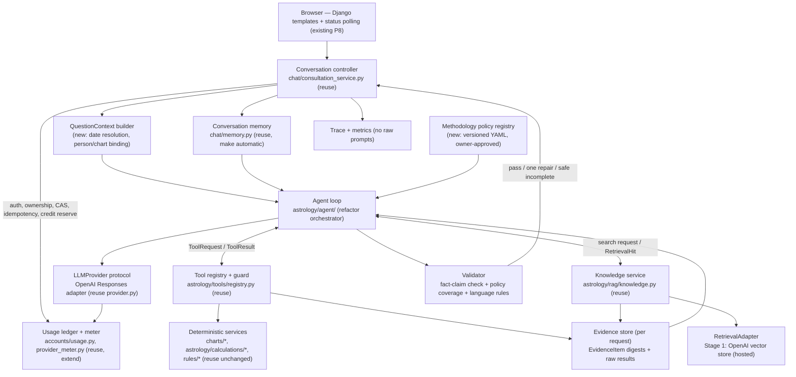
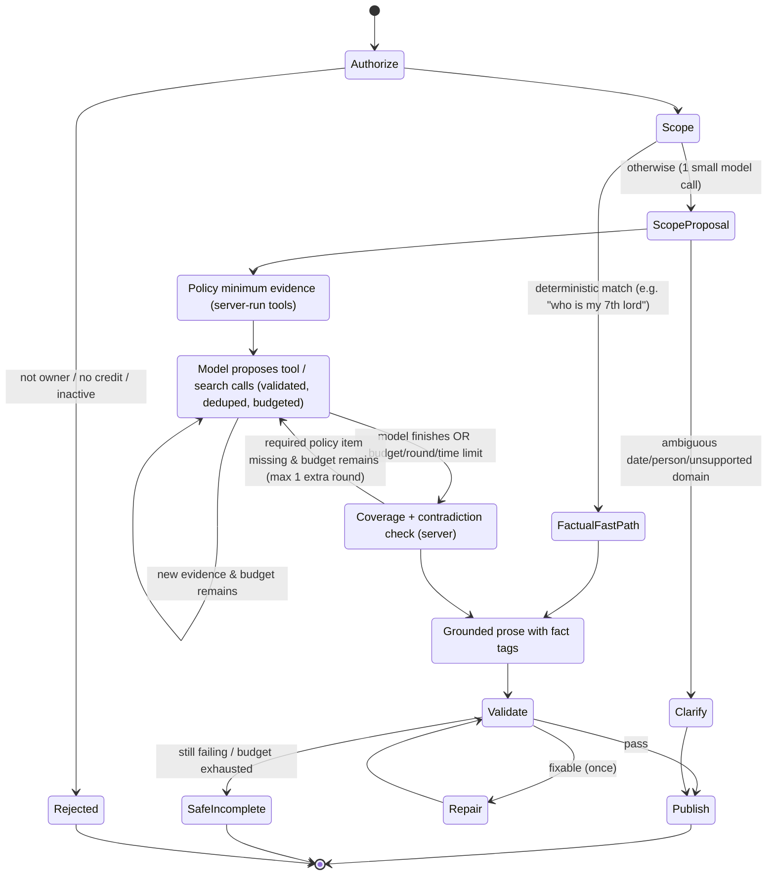

# AstroGPT — TO-BE Architecture Proposal (M0)

**Author:** Claude Code  
**Date:** 2026-11-10  
**Status:** PROPOSAL for owner approval. Nothing here is implemented, and nothing in it authorizes M1.  
**Basis:** `CLAUDE_AS_IS_VERIFICATION.md` (findings cited as AS-IS §n), the handover, and the milestone tracker.  
**Binding constraint (handover, M2):** use the existing OpenAI vector store and its attached PDFs as the initial retrieval backend. Make retrieval replaceable, but build **no** pgvector, Qdrant, embedding pipeline or separate RAG server in the MVP.

---

## 1. Design goals in priority order

1. **Correctness boundary:** only deterministic Python produces chart, dasha, varga, transit, SAV or rule facts. The model never calculates.
2. **Useful, natural consultations:** the model *interprets* computed facts and retrieved principles in fluent prose, which today's closed-slot composer cannot do (AS-IS §1.3).
3. **Bounded cost and latency:** the application, not the model, enforces hard per-request caps. The prompt is compact and does not grow without bound across rounds.
4. **Automatic conversational continuity** within a conversation, under user privacy controls.
5. **Traceability:** every published astrological fact links back to a tool result. Every source claim links to a retrieval hit.
6. **Replaceability:** the LLM provider and the retrieval backend sit behind small protocols.
7. **Reuse over rewrite:** keep the `charts/` engine, the P2 tool registry, the P5 consultation service, the P7 ledger and the P8 hardening.

---

## 2. Recommended topology: single-agent modular monolith

**Recommendation:** keep one Django deployable. Use **one** reasoning agent per request inside the Django process, and call tools as **direct Python functions** through the existing registry.

| Alternative | Pros | Cons | Verdict |
|---|---|---|---|
| **A. Single agent in a modular monolith (recommended)** | No network hops; reuses ownership checks and ledger in-process; simplest to trace and test; matches existing code | Synchronous worker occupancy; a scaling ceiling later | **Adopt for M1–M8** |
| B. Multi-agent (planner + specialist sub-agents per system) | Specialisation; parallel investigation | Multiplies tokens and cost; harder budget control; double counting across agents; no evidence it improves astrology answers | Reject for MVP |
| C. MCP server(s) per calculation family | External reuse (e.g. Claude Desktop, partner tools) | Network hop per tool; separate auth; duplicated ownership logic | Defer. Add **one** optional MCP/REST façade over the same registry only if an external consumer appears. |
| D. Background-job agent (Celery/RQ) + polling | Frees web workers; survives restarts | New infrastructure (broker, workers); more failure modes | Defer to M7 if p95 latency exceeds the agreed threshold. The existing P8 status-polling UI already fits this later move. |

---

## 3. Logical architecture



**Dependency rule:** `chat` → `astrology.agent` → `astrology.tools` / `astrology.rag` → `charts` / `astrology.calculations`. The existing reverse imports (`astrology` → `chat.prediction_context`, `chat.timing_windows`; AS-IS historical §10) are tolerated in M1. They should be moved behind `astrology/` modules when touched, but not refactored for their own sake.

---

## 4. Core architectural decisions (with alternatives)

### D1 — Who decides question type, scope and investigation plan?

| Option | Description | Trade-off |
|---|---|---|
| 1. Regex planner (current) | `policy.py::make_plan` | Cheap and predictable, but only career/business, only 10th lord, brittle phrasing (AS-IS §1.4) |
| 2. Fully LLM-led | Model reads the question and picks tools freely | Flexible; risk of over-calling and cost; dates may be hallucinated |
| **3. Hybrid (recommended)** | (a) A **fast deterministic path** for unambiguous factual lookups (extend the regex to all 12 house lords, positions, current dasha, SAV). (b) Otherwise the model's **first** output is a structured *scope proposal* (`question_type`, `domain`, `target_person`, raw time expression). The **server** resolves dates, binds the chart, picks the methodology policy and runs its minimum evidence. The model then iterates within budget. | Keeps zero-LLM factual answers. Generalises beyond regex. Dates and authorization stay server-side. |

### D2 — How is the final answer written?

| Option | Description | Trade-off |
|---|---|---|
| 1. Closed slots (current P6) | Model selects canned sentences + fact IDs | Very safe, but not conversational and cannot interpret sources. Fails the product goal. |
| 2. Free prose + legacy keyword validator | Legacy path today | Fluent, but the validator checks section/keyword presence, not truth; it is fail-prone and repair is costly |
| **3. Grounded prose with fact tags (recommended)** | Model writes natural prose. Every calculated assertion carries an inline tag such as `⟦F12⟧`, referencing the fact catalog (`fact_catalog.py`, reused). The server verifies tagged values and **scans for untagged astro claims** (planet + sign/house/dasha/date/number patterns). Unsupported claims trigger **one** targeted repair; otherwise the server strips the sentence and marks the answer partial. Tags are rendered as hover/evidence links, not shown raw. | Fluent and auditable. The claim scanner needs careful pattern tests, which can reuse `claim_validator.py` and the P6 locked fixtures. |

### D3 — What evidence does the model see?

| Option | Trade-off |
|---|---|
| 1. Raw tool JSON, cumulative per round (current agent) | Rebuilds the 100k-token problem (AS-IS §7.2) |
| **2. Compact `EvidenceItem` digests + on-demand expansion (recommended)** | Each tool result is converted server-side into ≤ N short typed facts (e.g. `D10 · 10th lord · Saturn · placed 7th · own sign`) with IDs, plus a status of support/pressure/neutral/contradictory/unavailable. Raw results stay in the server-side evidence store. An `expand_evidence(id)` tool returns detail only when needed. Per-round payload target: **≤ 8k input tokens** for a career timing question (to be measured in M3). |

### D4 — Retrieval mechanism within the M2 constraint

| Option | Description | Trade-off |
|---|---|---|
| 1. `file_search` inside the synthesis call (legacy) | Model searches implicitly | Unobservable, uncited; reserves full context cost (AS-IS §9.2) |
| 2. Separate Responses call with forced `file_search` (P4 adapter) | Observable hits | One extra LLM round-trip per search; consumes a "round"; full-context reservation |
| **3. Direct vector-store search API behind `RetrievalAdapter` (recommended, subject to M2 verification)** | `client.vector_stores.search(...)` (present in installed SDK 1.109.1) returns ranked chunks + file attributes **without** a generation call | Cheaper and faster; no model tokens; does not consume an agent round. **Pricing, rate limits and ranking quality must be verified in M2** before adoption. If unsuitable, keep option 2. |
| 4. Own RAG (pgvector/Qdrant) | Full control | **Out of scope by owner constraint.** Future option only. |

### D5 — Conversational memory default

| Option | Trade-off |
|---|---|
| 1. Per-conversation opt-in checkbox + message numbers (current) | Privacy-maximal, but manual; contradicts the handover's "automatic" goal |
| **2. Automatic within a conversation, with an account-level privacy preference (recommended)** | Default ON for new conversations after a one-time clear disclosure. One toggle per conversation and one in account settings. The message-number fields are removed: the model resolves references from the bounded recent turns, while corrections are still recorded deterministically. No cross-conversation or cross-chart memory. |
| 3. Account-wide long-term memory | Personalisation | Privacy and consent burden; risk of predictions becoming "facts". Reject for MVP. |

### D6 — Model-round state

| Option | Trade-off |
|---|---|
| 1. Stateless re-send of everything (current) | Simple, but cost grows per round |
| 2. Provider-side state (`previous_response_id`, requires `store=true`) | Fewer resent tokens; provider retains data, which weakens the privacy stance and adds provider lock-in |
| **3. Server-held compact transcript, `store=false` (recommended)** | Send the system policy + `QuestionContext` + memory digest + evidence digests + only the latest tool results. The prefix stays stable so prompt caching can apply. |

### D7 — Model selection

Only `gpt-4o-mini` is priced (`usage_policy.py:5-7`). **Recommendation:** add a model/tariff registry entry per approved model, and allow separate models for (a) the scope proposal and (b) final interpretation. Keep `gpt-4o-mini` as the default until M8 evaluation shows otherwise. The choice of models and spend is an owner decision (§12).

### D8 — Legacy pipeline

Freeze it as the **rollback path**: no new features. Fix only security defects (raw exception text, question logging, unmetered classifier) because it serves live traffic. Retire it after the M8 go decision.

---

## 5. Contracts (conceptual schemas; implementation in M1/M3)

All contracts are versioned (`schema_version`), JSON-serializable and size-bounded. Ownership: **C** = controller (`chat/`), **A** = agent (`astrology/agent/`), **T** = tools, **K** = knowledge, **L** = ledger (`accounts/`).

```python
@dataclass(frozen=True)
class QuestionContext:            # owner: C (built), read-only to A
    schema_version: int
    request_id: UUID              # idempotency key (existing UsageRequest)
    user_id: int                  # trusted server principal, never from model
    chart_id: int                 # authorized chart bound to conversation
    conversation_id: int
    question_text: str            # <= 4096 UTF-8 bytes
    locale_today: date            # user-local "today" for relative dates
    timezone: str
    question_type: Literal['factual','interpretive','predictive','comparative','followup','unsupported']
    domain: str                   # 'career','business',... (policy key)
    time_windows: tuple[tuple[date, date], ...]   # server-resolved, inclusive
    time_resolution_note: str     # e.g. "'next year' = 2027-01-01..2027-12-31"
    target_person: Literal['chart_owner','other_unbound']
    method_profile: str           # e.g. 'lahiri-truenode-wholesign-v1'
    policy_id: str | None         # e.g. 'career.predictive.v1'

@dataclass(frozen=True)
class ToolRequest:                # owner: A proposes, T validates
    tool: str                     # allowlist name
    arguments: dict               # chart_id injected by server
    reason: str                   # <= 400 chars, recorded in trace
    optional: bool                # False = policy minimum evidence

@dataclass(frozen=True)
class ToolResult:                 # owner: T (existing P2 envelope, extended)
    schema_version: int
    tool: str
    status: Literal['ok','partial','unsupported','error']
    data: dict | None             # raw; stays server-side
    warnings: list[str]
    method: dict                  # precision, interval_convention, method_profile
    provenance: dict              # chart/engine/request fingerprints
    error: dict | None

@dataclass(frozen=True)
class EvidenceItem:               # owner: A (derived from ToolResult/RetrievalHit), the ONLY thing the model sees by default
    evidence_id: str              # 'E3.2' (tool result 3, fact 2) or 'K1'
    kind: Literal['calculated_fact','rule_conclusion','timing_hypothesis','source_viewpoint']
    system: Literal['parashari','jaimini','varga','yogini','transit','ashtakavarga','classical_source']
    statement: str                # compact canonical text, <= 200 chars
    canonical_values: dict        # exact values the validator checks (planet, sign, house, dates, points)
    direction: Literal['support','pressure','neutral','contradictory','unavailable']
    roots: frozenset[str]         # shared underlying facts, e.g. {'D1:10L=Saturn','VIM:MD=Saturn'}; used to prevent double counting
    window: tuple[date, date] | None
    source_tool_result: str       # back-reference for audit

@dataclass(frozen=True)
class RetrievalHit:               # owner: K
    hit_id: str                   # 'K1'
    source_id: str                # from the corpus manifest, not inferred from filename
    file_id: str
    title: str | None
    tradition: str | None
    locator: str | None           # page/section ONLY if provided by metadata
    excerpt: str                  # <= 1200 bytes, untrusted text
    score: float | None
    query: str
    retrieved_at: datetime
    rights_status: Literal['cleared','internal_only','unknown']

@dataclass
class ConsultationSummary:        # owner: C (deterministic, existing memory.py v1 → v2)
    schema_version: int
    chart_id: int
    epoch: int
    domain: str | None
    windows: list[tuple[date, date]]
    open_questions: list[str]                 # user's unresolved asks
    user_assertions: list[dict]               # unverified, with message_id
    corrections: list[dict]
    prior_answer_refs: list[dict]             # 'preliminary_not_a_fact'
    evidence_refs: list[dict]                 # tool + fingerprint; recalculate before use

@dataclass
class BudgetState:                # owner: L (authoritative), mirrored read-only to A
    policy: str                   # plan + question_type envelope
    rounds_used: int; rounds_max: int
    tool_calls_used: int; tool_calls_max: int
    input_tokens_reported: int; output_tokens_reported: int
    tokens_reserved: int; tokens_max: int
    searches_used: int; searches_max: int
    cost_reserved_usd: Decimal; cost_max_usd: Decimal
    deadline_monotonic: float
    exhausted_reason: str | None
```

**Boundaries:** the model never supplies `user_id`, `chart_id`, dates outside `time_windows`, tool names outside the allowlist, or a source locator not present in a `RetrievalHit`.

---

## 6. Agent state flow



`SafeIncomplete` publishes a deterministic evidence summary (reuse `agent/rendering.py`). It is clearly labelled incomplete and **is not charged** (existing `settle(delivered=False)` behaviour).

---

## 7. Policies: stopping, cost, errors, conflicts, missing data, history, grounding

| Concern | Policy |
|---|---|
| **Budget envelope** | Per (plan × question_type), enforced by `BudgetState` in the existing meter. Proposed starting envelope, to be measured in M3 and owner-approved: factual = 0 LLM calls; interpretive = ≤3 rounds, ≤1 search; predictive = ≤4 rounds, ≤2 searches; hard cost cap per request; existing daily cap retained. |
| **Stopping** | Stop when: the model finishes; or a round/call/token/cost/time cap is hit; or two consecutive rounds add no new evidence (dedup); or the policy minimum is satisfied and the model requests only low-value repeats. |
| **Tool error** | `error`/`unsupported` results become `EvidenceItem(direction='unavailable')`. The model must disclose them. No retry of deterministic tools; at most one retry for a transient provider *connection* error, **before** any bytes are accepted (no double billing). |
| **Source conflicts** | Different `RetrievalHit`s stay separate viewpoints. The answer must name the disagreement. Sources never override calculated facts. |
| **Calculation conflicts** | Contradictory `EvidenceItem`s are both surfaced. `neutral`, `contradictory` and `unavailable` stay distinct (handover §3 step 4). Agreement is scored on **distinct roots**: items sharing a root count once. |
| **Missing data** | Always `unknown`/`unavailable`, never 0. A missing optional system lowers stated confidence; it never counts as opposing evidence. |
| **History boundaries** | Same conversation + same chart + current memory epoch only. Prior answers are `preliminary_not_a_fact`. Fresh tool results always override remembered values. |
| **Ungrounded claims** | Validator rejects untagged astro assertions, numbers or dates not in the catalog, invented citations, percentages or probabilities, and certainty language. One repair, then strip-and-mark-partial. |
| **Confidence language** | Qualitative only ("limited", "moderate", "stronger traditional support"). No percentages (tracker cross-cutting constraint). |

---

## 8. Methodology policy registry

- Location: `astrology/policies/*.yaml` (new). It is versioned, owner-approved, and loaded and validated strictly: invalid files **fail closed**, unlike today's advisory rule loader.
- Key: `domain × question_type × horizon`. Contents: required minimum evidence, optional investigations **with triggers**, interpretive heuristics labelled `owner_heuristic`, and explicit prohibitions (e.g. "do not apply D10 checks to marriage").
- **First policy: `career.predictive.v1`.** It encodes the owner's worked example (handover §3): relevant-period MD/AD; MD/AD-lord links to D1 houses 1, 5, 6, 8, 10, 11 (12 when foreign); D10 confirmation; Chara Dasha/Amatyakaraka; Yogini corroboration; scoped MD/AD-lord transits with natal-sign SAV; 10th-lord transit; Jupiter aspect to the 10th, weighted higher when Jupiter is an MD/AD lord. Every heuristic stays labelled "not a probability".
- Simple factual career questions use `career.factual.v1` (D1 only). Other domains get policies only after astrologer review (handover §3 final paragraph).

---

## 9. Retrieval and corpus (staged, vendor-independent)

| Stage | Scope | Milestone |
|---|---|---|
| **S0 (today)** | Hosted `file_search`, unobserved in legacy; P4 adapter disconnected | — |
| **S1: inventory + manifest** | One authorized read-only listing of the configured store (`vector_stores.files.list` + file metadata): IDs, filenames, status, last errors, attributes. Build `astrology/rag/corpus_manifest.yaml` with `source_id`, title, tradition, provider `file_id`, local filename, SHA-256 of the local PDF where available, page-offset notes and `rights_status`. Missing or failed files are explicit. | M2 |
| **S2: adapter + citation tests** | `VectorStoreSearchAdapter` (direct search) or the existing forced-`file_search` adapter, chosen by a measured comparison. A locked 20–30 query retrieval test set built from the owner's methodology concepts, checking hit relevance (owner-rated), document identity and no-invented locators. | M2 |
| **S3: curated notes** | Short owner-reviewed Markdown notes for high-value methodology and exceptions (paraphrased, no long book text), uploaded to the **same** store with `tradition`/`source` attributes. | M2/M4 |
| **S4: independent RAG (future)** | Parse PDFs into page-aware chunks, embed and index (e.g. PostgreSQL + pgvector), behind the same `RetrievalAdapter`. **Not in MVP.** | Post-M8 option |

**Quality risks to track:** OCR quality of scanned books; no page metadata in hosted results; duplicate or overlapping books; licence status (one PDF appears to be a website capture, AS-IS §11.2); retrieval drift after re-upload (bump `ASTROGPT_KNOWLEDGE_VERSION`, already supported by the P4/P7 fingerprint).

---

## 10. Thin-slice integration plan (M3) and rollback

1. **Per-user flag** instead of the global `ASTROGPT_AGENT_ENABLED`: an operator-managed allowlist (setting or DB flag) routes only listed accounts to the agent. Everyone else stays on legacy.
2. Persist `pipeline` (`legacy`|`agent`), `policy_id`, `method_profile` and `trace_id` on every assistant message (extend the existing `chat/evidence_manifest.py`).
3. Slice content: one factual question (A-01) and one career predictive question (A-02) for **one operator account**, with a per-request cost cap approved in advance.
4. Required trace artefact: Django view → `append_turn` → agent → each tool (name, args digest, duration, bytes) → each model round (reported tokens) → validator verdict → ledger settlement.
5. **Rollback:** remove the user from the allowlist (no restart needed if DB-backed). The global kill switch stays. No schema reversal.
6. **Optional shadow mode** (owner decision): run the agent offline on the same question with the provider mocked, to compare tool plans without paying twice.

---

## 11. Cross-cutting: provider adapter, observability, method disclosure, security

- **`LLMProvider` protocol:** `complete(system, messages, tools, response_schema, limits) -> Reply(calls, text, usage, raw_status)`. The OpenAI Responses adapter reuses `provider.py`, creates **one client per request** (not per call), uses `store=false` and zero SDK retries. All calls go through `responses_create`. The intent classifier and yearly predictions are migrated into the meter.
- **Token measurement:** use `token_budget.input_token_bound` (tiktoken) for **every** pre-dispatch check, including the agent (replacing `provider.request_size` bytes). Record provider-reported usage per round, plus a per-component token breakdown (instructions/context/evidence/tools) as aggregate numbers only.
- **Observability:** a `trace_id` per request; stage timings; no raw prompts, chart data or question text in logs (fix `intent_engine.py:226`).
- **Method profile (handover Q12):** a named, versioned profile (`lahiri · true node · whole-sign · 365.2425-day dasha year · noon-UTC daily transit samples · dasha periods [start,end)`). It is attached to every `ToolResult` and shown in the answer's evidence panel. Changing any element bumps the version and invalidates caches (the P2 fingerprinting already supports this).
- **Dasha boundary:** adopt **half-open `[start, end)`** as the single convention (already used by tools and the timeline). Route all inclusive call sites (AS-IS §8.3) through one selector in M1, after owner confirmation.
- **Security fixes to the legacy live path (M1):** no raw exception text in answers; no question text in logs; classifier metered with an explicit timeout and zero retries; conversation created inside the reservation transaction.

---

## 12. Decisions requiring owner approval

| ID | Decision | Recommendation |
|---|---|---|
| **OD-0** | Commit the current uncommitted P1–P8 working tree to a branch now (pure version-control safety, no code change) | **Yes, before M1**. Optionally squash per phase. |
| OD-1 | Topology: single-agent modular monolith, direct Python tools, no MCP for now | Approve |
| OD-2 | Planner: hybrid deterministic fast path + model scope proposal (D1) | Approve |
| OD-3 | Answer composition: grounded prose with fact tags + claim scanner, replacing closed slots (D2) | Approve. This is the largest product-quality lever. |
| OD-4 | Compact `EvidenceItem` digests with expansion on demand (D3) | Approve |
| OD-5 | Retrieval: evaluate direct vector-store search vs forced `file_search` in M2; adopt the cheaper option that passes the citation tests (D4) | Approve the evaluation; separate approval for the one listing call and the small paid search set |
| OD-6 | Memory default: automatic within a conversation, account-level opt-out, remove message-number fields (D5) | Owner privacy/legal call; recommended |
| OD-7 | Model and tariff choices; per-plan budget envelopes per question type | Owner (cost) |
| OD-8 | Dasha boundary convention: half-open everywhere | Owner (astrological method) |
| OD-9 | Rule double-counting fix: dedup by root/ID in the agent's evidence; leave legacy scores untouched | Approve |
| OD-10 | Swiss Ephemeris data files: provision `.se1` files and set the ephemeris path, or formally accept Moshier precision and disclose it | Owner |
| OD-11 | Source rights: which PDFs may be quoted to paying users vs used internally only | Owner/legal |
| OD-12 | Per-user agent allowlist for M3; optional shadow mode | Approve the allowlist |
| OD-13 | Legacy pipeline frozen except security fixes; retire after M8 | Approve |
| OD-14 | Synchronous execution with polling until M7; background worker only if p95 exceeds a threshold the owner sets | Approve |
