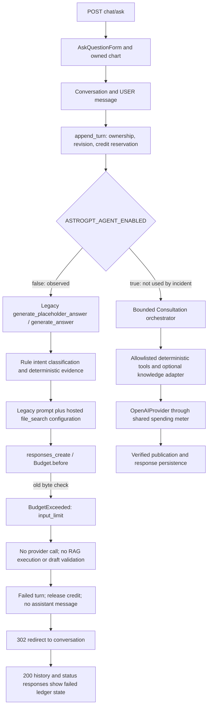

# Post-P8 runtime failure investigation

Investigation date: 2026-11-09. Scope: local runtime incident only; no P9, public rollout, or paid model calls.

## Finding and evidence

**Confirmed first failing component: the local P7 provider spending meter, before the OpenAI SDK dispatch.** The exception is `accounts.usage_policy.BudgetExceeded('input_limit')`, raised in `accounts.provider_meter.Budget.before()`.

This finding comes from the actual application database and an offline reconstruction using the affected saved chart, not from earlier phase reports:

- Both user-identified failed conversations have usage requests with `status=failed`, `stop_reason=input_limit`, zero provider-call rows, zero consumed credits, and one released reservation each.
- Effective settings loaded through Django: `astro_site.settings`, `ASTROGPT_AGENT_ENABLED=False`, model `gpt-4o-mini`. The flag is absent from both the local `.env` and the inspecting process's parent environment, so the default-off setting applies. Both key and vector-store configuration are present. Secret values were neither printed nor included here. Presence does not establish provider authorization or availability.
- Read-only reconstruction of the reported question produced approximately 309,334 bytes of evidence payload and 33,494 bytes of instructions. Serialized request framing increased the visible request to approximately 382 KB. The old guard compared those **bytes** directly with the **128,000-token** model context limit.
- Local tokenization of the reconstructed pre-compaction request gave a bound of approximately 124,244 tokens, including the 4,096-token framing allowance. Byte count alone was therefore a false rejection for this case.
- An independent synthetic chart generated an even larger request: token counting alone was insufficient for that chart. Its lifetime Yogini schedule was unnecessarily included in a one-year question. The fix also scopes that transmitted schedule to the question dates.
- After both changes, the affected-chart reconstruction contained approximately 255,850 payload bytes / 319,456 serialized request bytes and a 101,532-token input bound. It passes the guard with 1,200 output tokens and a conservative hosted-search reservation of **$0.02242000**, within the unchanged **$0.05** free-request ceiling.
- The local read-only readiness command now reports migrations current, wallets consistent, chart/conversation ownership consistent, and agent disabled. No pending request reservations were observed.

Measurements are diagnostic aggregates, not saved personal evidence. Sizes can vary with settings, dates and serialization. No customer chart was copied into a fixture or report. Application rows were inspected read-only; replaying the spending guard used `Budget(request_pk=None)` and did not create provider ledger entries or consume credits.

## Actual request trace



Source trace:

1. `chat/views.py::ask_question()` validates the form and chart ownership, creates/reuses the conversation, then calls `chat/consultation_service.py::append_turn()` / `_append_turn()`.
2. `_append_turn()` enforces ownership, revision, request identity and credits; persists the user turn; builds consent-scoped context; wraps generation in `accounts/provider_meter.py::request_budget()`.
3. `chat/agent_service.py::generate_question_answer()` selects the legacy path when the feature flag is false. It does **not** invoke the new orchestrator or silently retry a failed agent through legacy. The legacy function does not consume the supplied conversation context.
4. `chat/llm_engine.py::generate_answer()` classifies this question as specific through rules and calls `build_prompt_payload()`. Deterministic calculations/rules run before synthesis. Its configured hosted `file_search` is part of the proposed Responses request.
5. `accounts/provider_meter.py::responses_create()` calls `Budget.before()` before `client.responses.create()`. The original guard raises `input_limit` and stores that reason. No provider-call reservation/event is created because failure precedes dispatch.
6. `_append_turn()` catches `BudgetExceeded`, marks the turn failed, releases the credit and writes no assistant message. `accounts/pilot_ops.py::request_summary()` produces the generic failure label shown in the screenshot.
7. The HTTP 302 is a normal redirect after handling the form. The subsequent HTTP 200 responses mean the history/status endpoints rendered successfully; they do not mean an answer was generated. `astro_site/pilot_middleware.py::PilotMiddleware` logs transport status and duration, not semantic answer success. This explains the apparently successful console lines.

The screenshot console log and persisted stop reasons agree. Configured operational logging uses a sanitized console formatter; no persistent server log file was found in the inspected project configuration. A separate attachment to a running worker's environment was not available. The rendered contextual-unavailable warning independently corroborates the disabled agent flag for the observed page.

## Agent, tool, RAG and validation inspection

These are implemented but were **not reached by the incident request**:

- `astrology/agent/orchestrator.py::Consultation.run()`, `minimal_evidence()`, `execute()` and `investigate()`: server-side allowlist, chart scope, deterministic minimum evidence, deduplication, tool/output/time/round/token limits and partial-result handling. Default `Limits` includes four rounds, 24 calls, 60 seconds and 100,000 conservatively reserved model units. The production provider's `request_size()` still uses a conservative byte bound for this separate orchestration budget; it can stop earlier than a tokenizer-based bound. This was not the recorded first failure and was not changed during this incident.
- `astrology/agent/provider.py::OpenAIProvider.definitions()` builds function schemas from the tool contracts; `complete()` uses Responses, a controlled final schema, no parallel tool calls, 20-second bounded timeout and no SDK retries.
- `astrology/rag/knowledge.py::KnowledgeSession` and `astrology/rag/hosted.py::HostedFileSearch.retrieve()` implement scoped retrieval, budgets and actual retrieval-result provenance. The hosted adapter requests included file-search results. Actual corpus coverage, citations and remote retrieval availability were not asserted from configuration alone.
- `astrology/synthesis/verified_answer.py::publish_answer()` validates agent output; `chat/publication.py::final_legacy_result()` validates the final post-processed legacy answer and prevents failed answers from entering the validated cache.
- `_append_turn()` independently rejects failed validation metadata and only consumes a credit for a complete, verified delivered answer.

The installed SDK supports the `max_tool_calls` Responses argument used by the meter. There is no evidence that a schema rejection, API credential failure, model outage, agent loop or answer-validation error caused these two requests: all such later provider/agent stages were bypassed or not reached. Their live success is **unverified**, rather than inferred from that absence of evidence.

## Why memory appeared contradictory

`Conversation.memory_enabled` stores user consent; it does not enable the agent. `chat/views.py::conversation_detail()` passes `settings.ASTROGPT_AGENT_ENABLED` separately to `templates/chat/ask.html`. With consent true and the agent flag false, the old template said both "Memory is on" and "Contextual answers are currently unavailable". Only the second statement described effective processing.

The template now says **"Memory consent is on; contextual processing is inactive."** when the agent is disabled. It retains "Memory is on" when both consent and agent processing are enabled. Consent, reset/deletion behavior, and ownership checks are unchanged. The opt-in agent flag remains disabled; enabling it is a separate local configuration/rollout decision, not an automatic error fallback.

## Changes

| File | Change |
|---|---|
| `accounts/token_budget.py::input_token_bound()` | Local model tokenizer counts serialized request tokens plus framing allowance. Unknown model mappings use a conservative byte fallback; tokenizer errors fail closed with `tokenizer_unavailable`. Special-token-looking user text is counted as ordinary untrusted text. No prompt is persisted or sent to a tokenizer service. |
| `accounts/provider_meter.py::Budget.before()` | Uses token units for the context check and leaves output headroom. Hosted search still reserves the full configured input context; financial, search, round, daily, credit and usage-overrun enforcement remains active. |
| `chat/llm_engine.py::_compact_live_evidence()` | Transmits every Yogini period/subperiod overlapping the requested dates instead of the entire lifetime schedule. Uses inclusive overlap; uncertain/missing period boundaries are retained. Does not mutate source evidence, calculate new dates, or change astrology mathematics. Records transmitted scope. |
| `requirements.txt` | Adds `tiktoken>=0.12,<1.0`. The verified local installation reports version 0.14.0. |
| `templates/chat/ask.html` | Separates memory consent from effective contextual processing in the displayed status. |
| `chat/test_runtime_failure.py` | Nine offline regression tests, including the exact reported question with real deterministic payload construction and a mocked SDK boundary. |

No schema migrations, customer data changes, math changes, feature-flag enablement, validation bypass, credit-policy relaxation or commercial phase work were performed.

## Regression scope and results

Existing failures and new issues are tracked separately:

- **Existing baseline:** the 108-test pre-fix targeted run (`accounts.test_usage astrology.test_agent chat.test_memory`) passed in 70.834 seconds. No pre-existing failure was observed there. Those tests largely used short synthetic provider requests or mocked generation, so they missed the oversized legacy integration.
- **New-test development finding:** the first new regression run had seven passes and one error: a different synthetic chart remained genuinely over context after tokenization. That uncovered the unnecessary lifetime Yogini schedule and led to the scoped transport fix; it was not classified as a pre-existing suite failure.
- **After fix:** the initial eight new regressions passed in 2.470 seconds. A ninth regression was then added to verify all overlapping periods are retained without mutating original evidence.

| Check | Result | Evidence / limitation |
|---|---|---|
| Actual failed ledger inspection | PASS | Both input-limit failures precede provider dispatch; credits released. |
| Affected-chart offline reconstruction | PASS | Corrected guard accepts the scoped request; no paid provider or application DB mutation. |
| New runtime regression suite | PASS | Included in final full-suite result below. |
| Full Django suite after changes | PASS | `manage.py test --noinput --verbosity 0`: 298 tests, 215.075 seconds, zero failures/errors. Includes all nine new runtime regressions. |
| Final tokenizer/runtime/billing verification | PASS | After normalizing the tokenizer installation, import and package metadata both report 0.14.0. `manage.py test chat.test_runtime_failure accounts.test_usage --noinput --verbosity 0`: 38 tests, 5.969 seconds, zero failures/errors. |
| `node --test scripts/test_pilot_ui.cjs` | PASS | Two existing UI protocol assertions pass. |
| `manage.py check` | PASS | No system-check issues. |
| `manage.py pilot_readiness --development` | PASS | Current migrations, consistent wallets and chart/conversation ownership. Agent disabled. This is not production readiness approval. |
| `python -m pip check` | PASS | No broken requirements. |
| Live OpenAI synthesis / file search / corpus coverage | BLOCKED / NOT RUN | No paid smoke call was made. Presence of configuration does not verify remote availability or final answer quality. |
| Browser retry against a reloaded local server | NOT RUN | No browser-driven submission or server restart was performed. Offline tests do not certify the currently running worker has reloaded. |

New test cases (`chat/test_runtime_failure.py`): large byte-sized JSON dispatches under token/cost limits; true token overflow blocks dispatch; output headroom; missing tokenizer fails closed; untrusted special-token literals; immutable inclusive Yogini scope selection; exact question with real calculations reaches the mocked provider while a deliberately invalid draft stays unpublished and releases credit; consent-on/agent-off wording; consent-on/agent-on wording.

The exact-question test deliberately supplies an invalid provider draft. It proves the first failing guard is fixed and downstream validation remains enforced; it does not claim a live successful astrological reading. Existing mocked agent, continuity, privacy and billing suites cover their separate contracts.

## Remaining issues and local verification

1. The new agent is still opt-in and disabled in this local configuration. Therefore follow-ups still run individually. To exercise the agent after reload, configure `ASTROGPT_AGENT_ENABLED=true` in the intended local environment. This incident fix does not silently enable it or alter rollout policy.
2. Install the declared dependency into the interpreter that runs Django. `tiktoken` obtains its public vocabulary on first initialization; preload it during environment preparation, with a persistent writable cache for the service account. This is a vocabulary download, not an OpenAI model request. Without vocabulary availability the guard fails closed. Local initialization and offline tests used the initialized cache.

   ```powershell
   .venv\Scripts\python.exe -m pip install -r requirements.txt
   .venv\Scripts\python.exe -c "import tiktoken; tiktoken.encoding_for_model('gpt-4o-mini')"
   ```

3. Reload/restart the intended local Django process so it imports the changed code and dependency. Feature-flag environment changes require a process restart. A restart alone would not have fixed the original byte/token comparison.
4. Large evidence can still legitimately exceed context, round, output, search or cost limits. Free policy permits one hosted search; a legacy validation repair that proposes a second hosted search is rejected by the unchanged search budget. The regression checks that such an invalid answer is not published or charged. Improving repair evidence reuse is separate work, not a reason to disable the guard.
5. The legacy structural validator is distinct from the agent's controlled factual publication mechanism. Passing local regressions does not establish a good remote-generated draft or mathematical correctness of every existing calculation.
6. No remote provider availability, index-content audit or paid end-to-end success has been claimed. A separately bounded live retry remains necessary to verify the complete deployed request. No past failed request was automatically replayed or charged.
