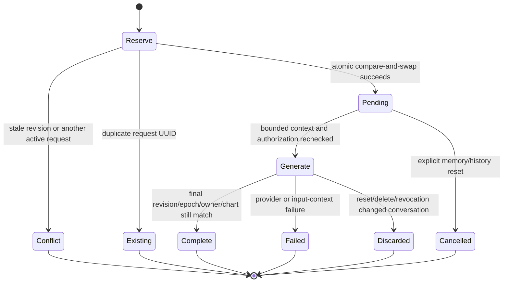

# P5 conversation and memory contracts

## Entry points

| Method / route | Purpose | Boundary |
|---|---|---|
| GET/POST `/chat/ask/` | Existing optional new-conversation flow; opt-in memory checkbox | Authenticated user selects an owned chart; no previous conversation context is imported |
| GET `/chat/ask/history/<id>/` | Existing authorized conversation view plus follow-up/memory controls | Owner only; an unavailable/reassigned chart cannot be used for new evidence |
| POST `/chat/conversations/<id>/followup/` | Append to the same conversation | Owner and chart owner, CSRF, UUID request key, expected revision |
| GET `/chat/conversations/<id>/memory/` | Inspect enabled state, revision and versioned summary | Owner/chart authorized; `Cache-Control: no-store, private` |
| POST `/chat/conversations/<id>/memory/action/` | Enable, disable, reset, clear history or delete | Owner, CSRF and expected revision; no GET mutation |

Routes are declared in `chat/urls.py`; views delegate to `chat/consultation_service.py`. These paths assume the existing `/chat/` URL mount. `Conversation` has an explicit user and selected chart. A populated conversation cannot be saved with a different chart/owner through model/admin save; follow-up parameters cannot rebind it. Existing chartless records are not guessed/backfilled, and cannot generate follow-ups. Their owner can still delete them. Direct privileged database updates are outside the public service contract.

`append_turn(user, conversation_id, question, request_id=UUID, expected_revision=int, kind=..., supersedes_message_id=None, reference_message_id=None, generator=None)` is the server service. The generator is injected only by trusted code/tests, never supplied by the agent or HTTP arguments. Result is `TurnOutcome(http_status, state, conversation_id, result)`; duplicate completion redirects/returns its existing state without a second generation.

Questions are bounded at 4096 UTF-8 bytes. Kinds are `question`, `user_fact`, or `correction`; assistant messages are always labeled preliminary `interpretation`. Explicit “Actually…”, “Correction…”, “I meant…” and “No,…” prefixes also mark corrections. An explicit correction target must be a user message from the same current memory epoch. Without a target, the latest eligible user message is referenced; that reference records the user's correction event, not a verified semantic fact match. The UI allows selecting the intended message explicitly.

## Concurrency and idempotency



The reservation transaction increments `Conversation.revision`, sets its active UUID and creates an ordered `ConsultationTurn` plus user message. Provider execution occurs after commit. A short final transaction compares revision, epoch, active request, conversation owner and current chart owner before saving the assistant/summary. A reset/deletion cannot be undone by a late result. No ORM lock is held while calling a provider.

Revision/active-request predicates stay directly on the updated conversation row rather than inside a related-table update subquery. Short reservation/finalization transactions separately authorize and, where supported, lock the selected chart row; no chart lock spans provider execution. SQLite ignores row-level `select_for_update`, so the direct compare-and-swap and explicit database-busy handling remain necessary.

Database uniqueness covers `(conversation, request_id)` and `(conversation, sequence)`. A duplicate completed key yields existing completion; pending/failed/cancelled keys and stale/overlapping submissions return an explicit conflict. SQLite lock/serialization/deadlock contention is returned as conflict without an automatic paid retry. Completed retries are available even if their first answer exhausted the remaining allowance. Failed requests require a fresh UUID to retry. Request identity is scoped to the conversation, not a global chat session.

`ConsultationTurn.sequence` follows monotonically increasing conversation revisions; reset actions may create gaps. Message display order is stable `created_at, id`. A crashed worker can leave an active marker. The owner must explicitly reset memory/history to cancel it rather than silently replay a possibly paid request. This is a bounded synchronous consultation implementation, not a distributed job queue or P7 exactly-once billing ledger.

## Memory schema and budgets

Summary version is integer `1`; stored in `Conversation.memory_summary` only with explicit consent. `chat/memory.py` assembles it deterministically:

```json
{
  "schema_version": 1,
  "chart_id": 123,
  "epoch": 0,
  "topic": "job",
  "windows": [["2027-05-01", "2027-05-31"]],
  "user_assertions": [],
  "corrections": [],
  "deterministic_references": [],
  "interpretations": []
}
```

This is an illustrative ID/date example, not a real consultation. User assertions retain message ID, bounded text and unverified/superseded status. Corrections retain their own message ID, referenced user-message ID, bounded text and unverified status. Deterministic entries hold source message/tool/chart fingerprint **references**, not raw chart facts, birth inputs or source-book text; facts must be fetched again. Assistant entries hold message ID and preliminary/result status only. Their prediction text is never summarized into verified facts. Older entries age out explicitly under the cap; this is not permanent exhaustive memory.

The active topic/periods come from deterministic plan events, not dates invented in prior assistant prose. Explicit new dates override earlier scope; an explicit comparison can retain one prior plus one requested window. A correction never edits/recalculates birth inputs. Birth-detail corrections instead ask the user to edit/recalculate the saved chart and start a new consultation.

| Context component | Limit |
|---|---:|
| Compact summary | 4096 UTF-8 bytes |
| Recent requests | Last 3 eligible turn records |
| Prior messages | At most 6, including failed-turn user messages where applicable |
| Each selected message text | 640 UTF-8 bytes, Unicode-safe truncation |
| Older reference | One explicit message ID, same conversation and consent/reset epoch |
| Current user projection | Categorized bounded text and correction reference |
| Entire memory context | 12,288 UTF-8 bytes |
| Summary assertion/correction entries | At most 6 each |
| Summary calculation references | At most 8 |
| Summary interpretation references | At most 3 |

The context adds `conversation_id`, chart ID, epoch, summary, categorized recent messages, current user projection and optional older reference. Context assembly uses bounded SQL selections, not the full transcript. It is sent as **untrusted data** in the agent payload and included by the existing provider token reservation. Prior assistant content remains unverified interpretation even when it quoted a calculation; fresh deterministic tools are authoritative.

No additional summarization API call is needed. No global/profile summary or cross-chart cache is introduced. Explicit older reference lookup is supported; autonomous unbounded history retrieval is not. Unsupported summary versions/bindings are discarded rather than silently treated as compatible facts.

## Follow-up scope examples

`astrology/agent/continuity.py::plan_with_context` resolves a deliberately bounded English subset:

1. “When might I get promoted in May 2027?” establishes career/May for that chart.
2. “What about D10?” requests D10 only, with that topic/period recorded as rationale.
3. “What about Jupiter in Leo?” fetches Jupiter transits for May 2027, instead of silently starting a new three-year scan.

“Compare with late 2027” compares the previous period with **October–December 2027**, stating that convention. More precise dates can narrow it. “Actually I meant July 2027” replaces the active requested dates while preserving correction provenance. “What about my wife?” asks for a new conversation with that person's selected chart. A reset removes inherited scope; an elliptical D10 request then asks for clarification rather than resurrecting an old period.

This is not a general natural-language memory resolver. Additional topics/date phrases remain limited by P3's existing policy, and fluency/claim-level answer validation remains P6. Current replies remain preliminary deterministic evidence reports.

## Consent, removal and allowance compatibility

See [memory policy](PHASE_05_MEMORY_POLICY.md) for the user-facing choices and retention caveats. Memory is off by default on existing records. Opting in later starts at the current message boundary; pre-consent messages are not silently sent. Reset/disable increments the epoch, clears summary, advances the floor and invalidates active results. Clear history deletes transcript/summary while retaining payload-free cancelled request tombstones to prevent replay. Delete conversation removes those too.

A context/state recheck immediately before provider dispatch avoids sending a snapshot that was already reset. A request already dispatched cannot be retracted; finalization still discards its result after reset/deletion/revocation. No source/memory cache persists across requests. Existing chart-calculation caches are not transcript memory and continue to use P2's user/chart fingerprints and authorization.

Privacy deletion must not reset the existing question allowance. `ErasedAnswerUsage` retains only a per-user integer count, with no conversation/chart/text/birth data. `accounts/credits.py::successful_answer_count` adds it to surviving assistant-message counts. This preserves existing counting behavior and does not implement billing rates, provider cost accounting or a P7 ledger.

Conversation/detail/history responses are marked non-cacheable; summary JSON explicitly uses no-store/private. Model string representations no longer include titles or message excerpts, reducing accidental private content in administrative object logs. The implementation adds no generic telemetry or raw-content logging. It does not guarantee removal from browser state already displayed, backups or provider infrastructure.

## Migrations and operation

Additive migrations:

- `chat/migrations/0004_scoped_consultation_memory.py`.
- `chat/migrations/0005_erased_answer_usage.py`.

Automated tests apply them only to Django's isolated test database. **The application database has not been migrated by this task.** Review/apply migrations before serving this code. For this checkout, the normal local deployment command is:

```powershell
.\.venv\Scripts\python.exe manage.py migrate
```

The existing `ASTROGPT_AGENT_ENABLED` flag controls agent-backed contextual generation. When it is false, follow-up messages may still append, but the legacy generator processes each question independently and the UI says so. No paid fallback/retry pipeline was added. Enable the flag only under the deployment's accepted rollout procedure.

Disable the flag to return to legacy generation. Keep additive schema/counters in place during rollback; dropping them would remove memory and erased-answer allowance history. Roll back view/service code only with matching models/migrations and an appropriate database backup. No production migration reversal was run.
