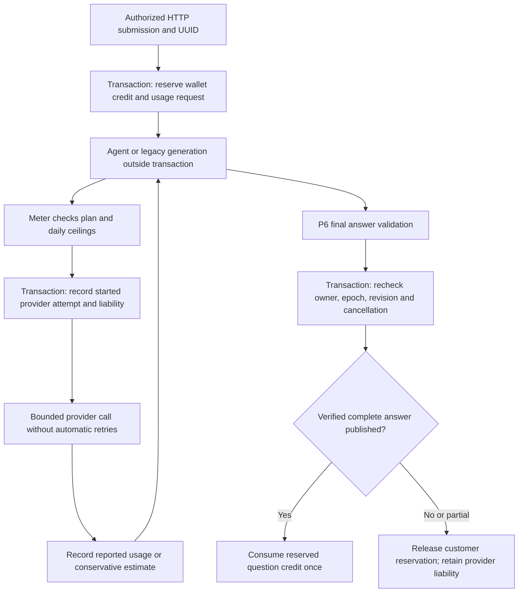

# P7 usage, credits and resilience contracts

Implemented on `feature/usage-ledger-p7`, HEAD `2312a4274ceb566ddc0d9f011516d60b459233c0`. P7 only. The user explicitly authorized proceeding assuming P6 approval; P6's unperformed human/live evaluations remain unperformed. No P8, paid pilot, deployment, production migration execution or astrology changes occur here.

## Customer request boundary

Both initial question submission and follow-up generation use `chat/consultation_service.py:_append_turn`. It authorizes the selected user/chart/conversation, reserves credit and creates a usage row inside the initial short transaction, calls the generator outside database transactions under `request_budget`, and settles in the transaction that publishes the assistant message. Existing revision/epoch/idempotency protections remain. A supplied failed validation never publishes. P6 partial answers can still be shown, but are free under this policy.

`accounts/usage.py:reserve` independently verifies ownership, reloads the chart from the database and HMACs chart identity/content, question, language and depth into a private request fingerprint. No question text is retained in the financial ledger. `UsageRequest` has a database unique constraint on `(user, request_id)`. A reused UUID never creates another paid attempt. Changed content with an existing initial-submit UUID returns a conflict. Completed follow-up retries remain available when credits are exhausted. Failed/cancelled IDs are not automatically retried; submit a fresh intentional request to try again.

Initial forms now contain a UUID. Older clients without the field use a stable per-session form UUID; they must open a fresh GET form for an intentionally new question. Simultaneous initial submissions may leave an empty losing conversation, but cannot create duplicate ledger reservations/provider dispatch. Follow-up UUIDs remain explicit. Duplicate responses return the original conversation or a conflict, not a second reading.

## Credit accounting and settlement

`CreditAccount` stores nonnegative consumed/reserved integers. On first use, consumed credits bootstrap once from existing assistant-message counts plus `ErasedAnswerUsage`; historical answers are not charged again. Subsequent balances use the wallet, not message counts, so deleting a reading cannot replenish credits and a partial answer does not accidentally spend one. Existing grant semantics are retained: current plan allowance plus bonus credits, not an invented monthly reset despite the legacy Plan model's monthly field name.

Reservation uses one conditional database update against `consumed + reserved < allowance`. There are at most **two outstanding requests per user**, including when `ENFORCE_QUESTION_LIMITS` is false. That switch disables customer allowance enforcement only, not provider budgets, daily limits or concurrency controls. Transaction failures/SQLite write contention fail closed with 409 and no provider call. No database lock is held during network generation.

| Outcome | Customer credit policy |
|---|---|
| Authorized, published `ok` reading, passing validation, complete investigation | Consume one reserved question credit |
| Deterministic factual result or validated answer-cache hit meeting the same conditions | Consume one credit for delivered value; provider cost may be zero |
| Partial/fallback after failed draft, provider error, timeout, missing evidence, budget stop or failed validation | Release reservation; consume zero |
| Cancellation, reset/deletion during generation, ownership/revision/epoch change | Release reservation and discard late answer |
| Refund of a completed request | Return the customer question credit once; do not erase provider cost |

`settle` and `refund` are transactional and idempotent. A conditional terminal state transition and nonnegative wallet predicates prevent double settlement. Publication rechecks and locks the usage row so a previously cancelled/refunded request cannot publish a late answer. Refunds here mean **question-credit refunds**, not payment-gateway or provider invoice refunds. No automatic cash refund, subscription payment allocation or payment webhook rewrite is introduced.

## Financial schema

| Model | Stored data |
|---|---|
| `CreditAccount` | User, consumed credits, reserved credits |
| `UsageRequest` | User/chart/conversation references, UUID, plan/policy snapshot, HMAC fingerprint, status/stop reason, credit reservation/settlement, estimated provider cost, optional invoice actual and explicit revenue/payment/infrastructure allocations, timestamps |
| `ProviderUsage` | Request/sequence, requested model, tariff snapshot, reservation input/output bounds, nullable provider-reported input/output/cached tokens, reserved and observed file-search counts, reserved/rated cost, observed cached discount, status/sanitized error code, timestamp |

There is no question, answer, birth input, prompt, retrieved excerpt or generic exception text in these models. User/chart IDs remain private linkable financial metadata, not anonymous telemetry. Financial rows survive conversation deletion (`SET_NULL`) and chart deletion (`SET_NULL`). User/account deletion currently cascades these records; long-term statutory/accounting retention is not newly designed by this phase. The UI now explicitly explains retained credit/usage records. Consent-scoped summaries and conversation deletion behavior otherwise stay unchanged.

Request states include `reserved`, `running`, `succeeded`, `failed`, `partial_free`, `cancelled`, `refunded`, `abandoned_unknown`. Provider states include `started`, `reported`, `estimated`, `error`, `overrun`. `stop_reason` records a bounded machine code for a rejected paid dispatch. Per-call records provide token/model/tool detail instead of pretending one aggregate model generated every step.

## Common paid-provider boundary

`accounts/provider_meter.py:responses_create` is used by agent Responses requests, hosted file search, legacy regular/periodic generation and legacy repair. The customer service supplies a ContextVar request budget; all paid attempts for that request share it. Existing direct internal helper callers outside a customer request receive a conservative per-call cap, but do not create a customer ledger row: these are trusted Python APIs, not extra public endpoints. Any future public/background caller must establish the same request boundary before provider use. Offline mocks are explicitly injected and never live-billed.

Before spending, the meter validates the tariff/model/tool types, reserves the full possible input/output/file-search cost, checks request/daily ceilings, confirms the request is still active, and commits a `started` attempt. Estimated request liability is increased **before** external dispatch. Request reservations are not recycled when an early call reports less usage, keeping worst-case spending bounded. Provider SDK clients use `max_retries=0`. Legacy calls use a 20-second network timeout; agent calls use at most 20 seconds and the remaining consultation time. Hosted retrieval uses the existing tool/remaining-time bound (15 seconds normally, at most 60 with custom server limits). These are SDK network timeouts and cooperative application bounds, not a new process-kill mechanism. All paid Responses calls receive `store=False`, bounded `max_output_tokens` and `max_tool_calls=1`. Function tools remain the existing server allowlist; only file search carries a configured hosted-tool tariff. Unpriced hosted tools/models are rejected before dispatch.

Text input is conservatively bounded by UTF-8 serialized request bytes plus overhead. With file search, the entire configured model context is reserved because the retrieved provider-side context is not visible beforehand. This may stop a request early even when its eventual actual usage would fit. Missing/malformed token counts keep reservation-sized estimated liability; they do not become free zero-token calls. Cached-token discounts apply only when valid provider counts are observed. File-search reservation count and observed `file_search_call` count are separate; a response that offers search but executes none has zero observed calls. If observation is missing, the cost remains conservative. A provider usage overrun is recorded, blocks the answer/next dispatch and stops the request; the application cannot independently force an external provider to honor its API limits or tariff contract.

`rated_cost` uses configured tariffs and observed usage where available. `estimated_cost` uses rated values or reserved upper bounds where usage is unknown. **Neither is an invoice actual.** `actual_cost` stays null pending explicit invoice reconciliation, except no-provider requests, whose external provider cost is known zero. Raw provider errors are not stored. An in-flight call may still cost money after customer cancellation; its attempt/liability is retained, and subsequent calls/late publication are blocked.

## Default ceilings and configuration

Defaults in `accounts/usage_policy.py` are operational ceilings, **not approved selling prices or measured profitable budgets**:

| Plan | Paid rounds | Aggregate reserved token bound | Output/call | File searches | Request cost ceiling USD |
|---|---:|---:|---:|---:|---:|
| free | 2 | 160000 | 1200 | 1 | 0.05 |
| basic | 3 | 320000 | 1800 | 2 | 0.10 |
| premium | 4 | 500000 | 2400 | 3 | 0.20 |

Existing P3/P4 time/token/tool/round limits also apply; the tighter bound wins. Plan paid-round limits count both orchestration and hosted retrieval. Reaching a meter limit returns an explicit `spending_limit` partial agent result; legacy generation fails safely with released customer credit. The provider cannot authorize a larger budget.

Set Django `ASTROGPT_USAGE_POLICIES` to a plan-keyed mapping with `rounds`, `tokens`, `output`, `file_searches`, `cost`. Set `ASTROGPT_API_TARIFFS` to model-keyed mappings containing decimal-string `input`, `cached`, `output` (USD per million tokens), `file_search` (USD per call), integer `context`, and version/source metadata. Unknown models fail closed. Review tariffs and context limits before changing `OPENAI_MODEL`.

`ASTROGPT_DAILY_PROVIDER_CAP_USD` defaults to **1.00 per user per rolling 24 hours**, summed from conservative provider-attempt reservations across conversations, including failures/cancellations. A per-user database lock serializes those reservations; cached discounts do not replenish the daily risk budget. This limits repeated free-failure spending. It is not a global organization/provider-project cap or protection against multiple abusive accounts. Configure provider-project spending limits separately before commercial exposure.

The test tariff is dated/versioned and configurable: [OpenAI's published prompt-caching table](https://openai.com/index/api-prompt-caching/) supplies the GPT-4o-mini standard/cached/output example and [official API pricing](https://developers.openai.com/api/docs/pricing) supplies file-search call pricing. `accounts/fixtures/p7_tariff_v1.json` records exact offline expected arithmetic. This fixture is not an automatic current-price feed; operators must review current rates before live activation. No rates are inferred from LLM prose.

## Caching

Existing deterministic cache keys already include authenticated owner, chart content/input fingerprint, request, engine source/method/settings/library fingerprint, with a 300-second TTL and output-schema checks. They continue to authorize against the database before a hit. Natal facts and scoped transits remain read-only; no astrology calculations changed.

`KnowledgeSession` keeps its request-local cache and additionally reuses validated bounded passages within an authorized, memory-enabled conversation for 120 seconds. The key includes owner, chart fingerprint, engine fingerprint, conversation ID/epoch, normalized query and adapter/source/model fingerprint. Disabled memory and calls without a financial conversation context do not use the shared cache. Reset/delete/disable/changed chart prevent lookup of old entries; inaccessible old backend entries expire within the TTL. Errors are not put in the shared cache. Cache backend errors fall back to bounded retrieval.

Hosted fingerprints include vector-store ID, model and `ASTROGPT_KNOWLEDGE_VERSION` (default `unverified-v1`). Bump this version when adding/removing/reindexing files in the same remote store. The app **does not automatically detect remote index mutations**. TTL bounds reuse while an operator updates the source generation. No live corpus inspection was performed or claimed.

## Retry, cancellation and stale workers

No automatic paid retry, provider fallback or request replay. Database contention before dispatch returns 409; clients may retry the same UUID without duplicate spending. A failed UUID stays failed; a fresh submission is an intentional new attempt, still under daily limits. Conversations retain existing concurrency/revision checks. Reset/disable/clear/delete cancel pending requests and release their credits; account-level credit refunds also block late publication. Cancellation cannot undo an already accepted external call.

Run `python manage.py reconcile_usage` for a **dry-run** count of reservations older than 900 seconds. `--apply` terminally marks them `abandoned_unknown`, releases customer credits, clears matching active conversation pointers and marks pending turns failed. It preserves provider attempt cost estimates and never retries a provider. Minimum reconciliation age is 600 seconds, beyond existing bounded call/consultation lifetimes. Run this as an operator-controlled scheduled command if needed; no scheduler/dependency/background service was installed. A late worker is prevented from publishing or issuing more paid calls by the terminal request state.

## Contribution dashboard and billing distinction

`/accounts/contribution/` is login-required, active-superuser-only and `no-store, private`. Ordinary users/staff/partners cannot retrieve it. It aggregates by plan without question/chart/birth text or individual account identifiers. It shows allocated revenue minus provider variable cost, payment fees and allocated infrastructure, **before marketing/tax**. Known invoice actuals replace estimates where supplied. Any missing revenue/fee/infrastructure allocation keeps margin unknown. Provider estimates, known invoice totals, unknown counts, average and nearest-rank P95 request costs stay separate. These aggregates are not a controlled live pilot.

Financial admin is superuser-only. Usage/provider fields are read-only except explicit invoice/revenue/payment/infrastructure allocations on request rows; Django admin change logs record edits. A privileged action returns question credits idempotently. No commercial price, automatic gateway allocation or profitability claim is invented from `Plan.price_usd`.

Infrastructure allocations should include the chosen share of web/database/cache hosting and vector-store storage, rather than silently treating those as zero. Operators supply actual payment fees and an allocation policy; no guessed fee percentage or unearned per-credit revenue is hardcoded.

Customer model/tool usage is billed through the server's **API project/account**, separate from ChatGPT subscription or Codex usage allowances. Any explicitly offered promotional API credit is account funding, not proof that customer API requests are free or covered by an ordinary subscription. Keep provider gross/rated cost and any invoice credit/subsidy reconciliation distinguishable when choosing prices.

## Migration and rollout gate

Additive files: `accounts/migrations/0003_usage_ledger.py`, `0004_request_stop_reason.py`, `0005_reported_search_usage.py`, depending on existing P5 migrations. They were applied only in isolated test databases. Before deploying code, back up and review a staging migration plan, apply existing pending migrations plus these files with `python manage.py migrate`, verify a known-credit account and retry/refund behavior, then deploy to the intended database. No application-database migration was run here.

SQLite real-connection races are tested for no overspend; SQLite may reject both read-to-write upgrades, requiring a fresh request retry. Production PostgreSQL lock/isolation tests and process-restart tests remain deployment validation, not claimed by SQLite tests. No live test was authorized. The full P7 gate remains pending a separately approved capped run measuring average/P95 actual or explicitly rated live request costs, including failures/tool charges, and review of proposed prices using those measurements. No P8 implementation or public activation follows automatically.
